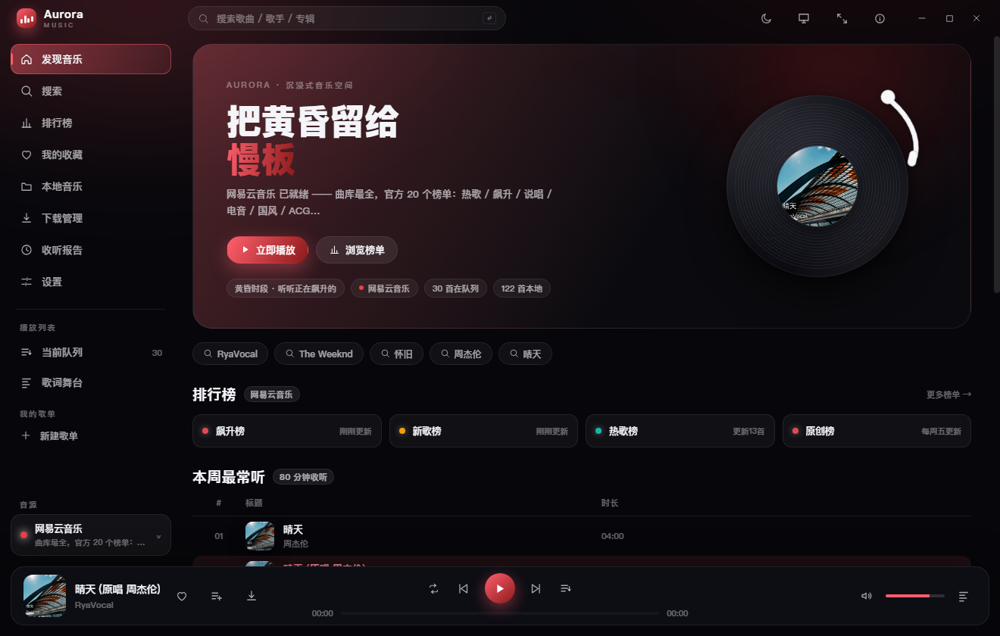
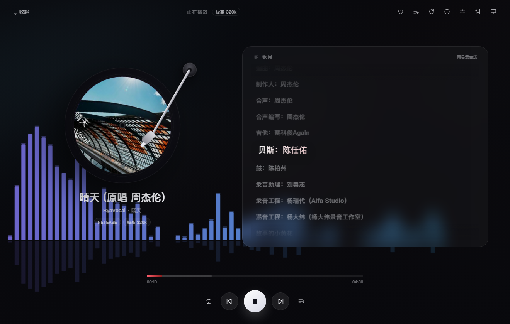
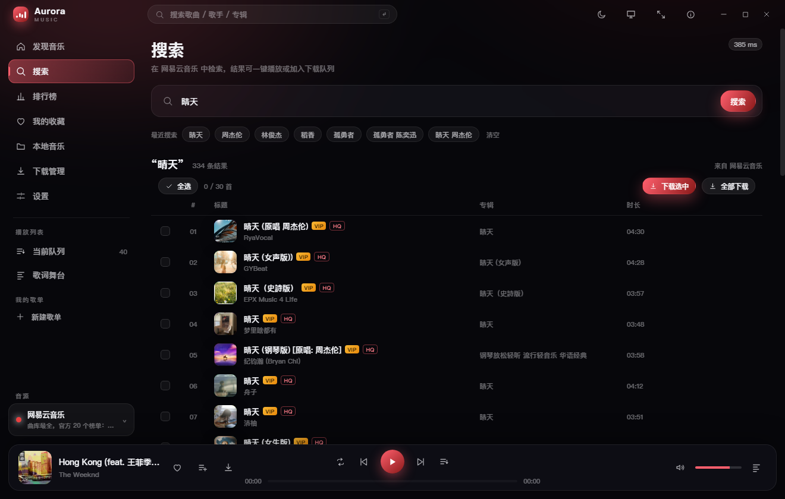
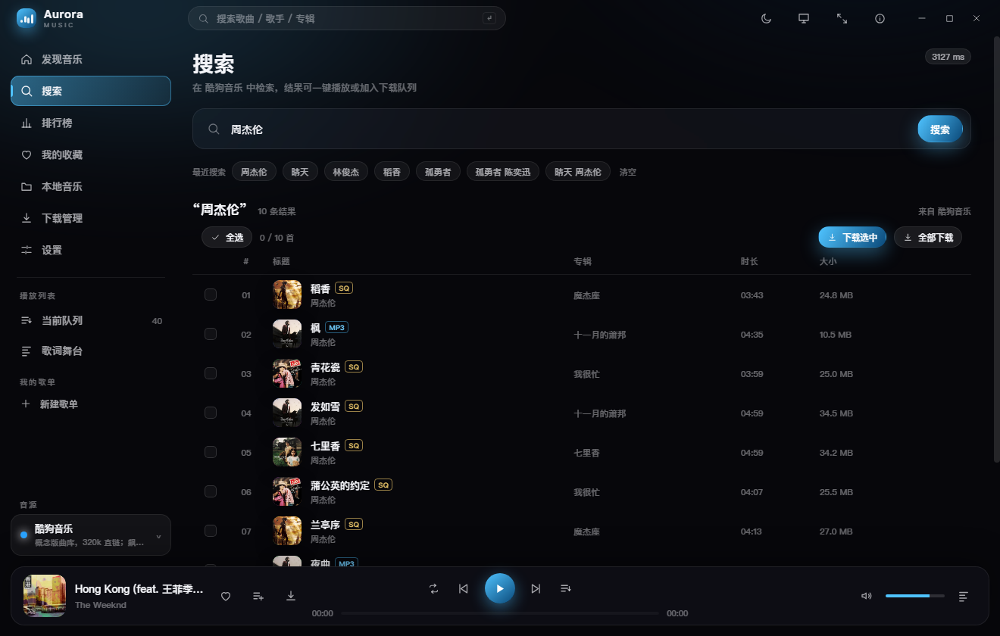
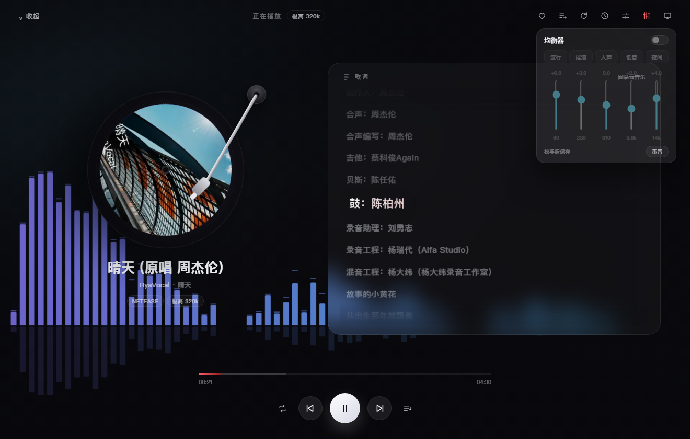
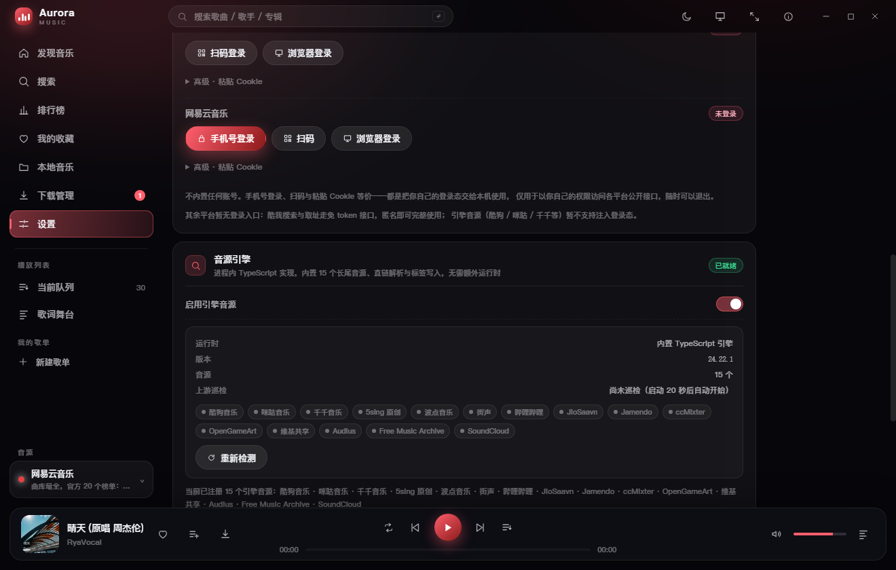
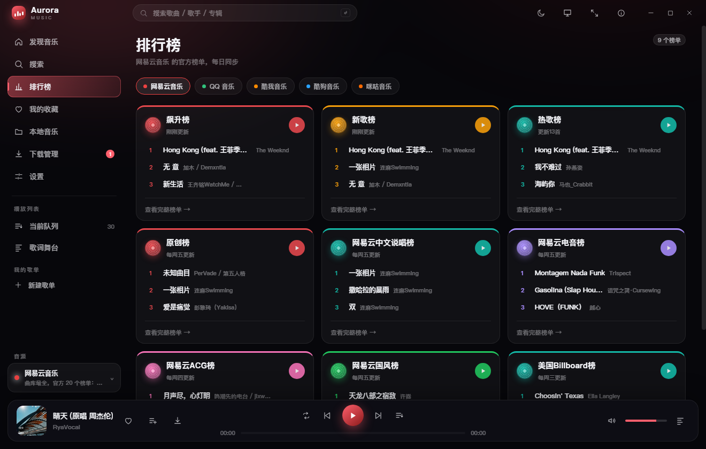
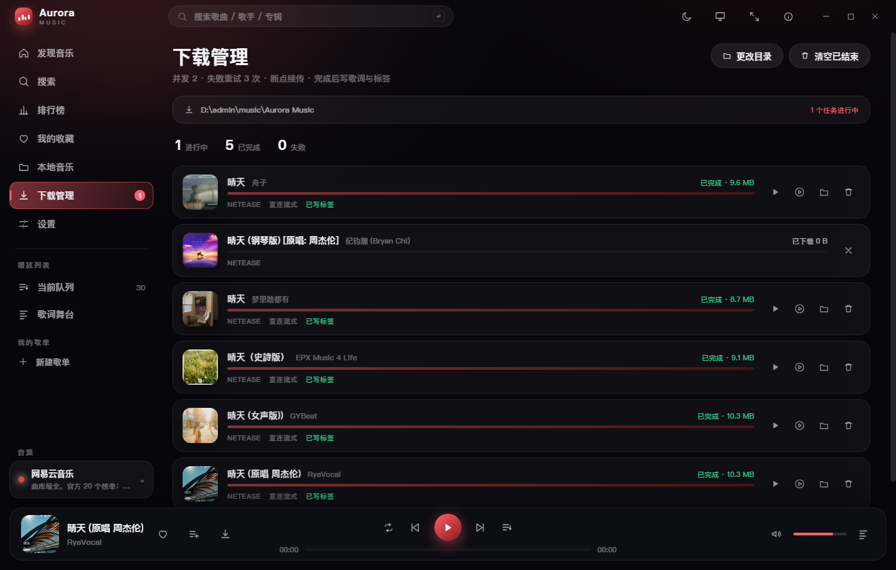
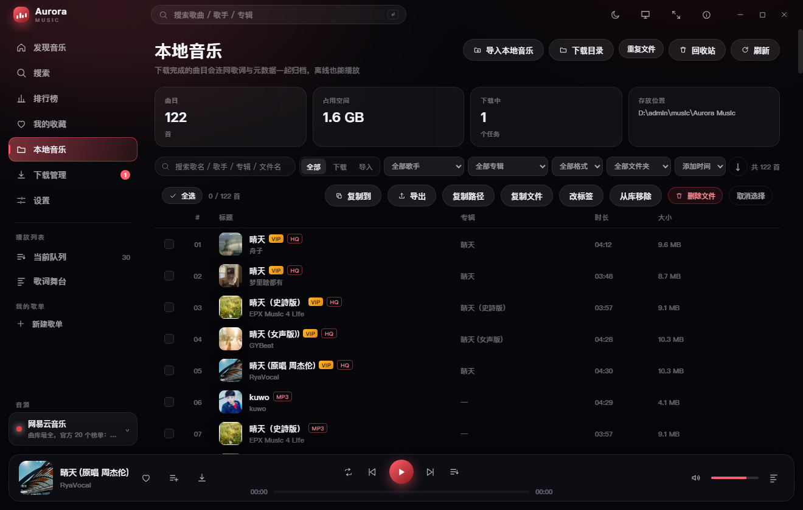

# Aurora Music

一款多音源桌面音乐播放器：**搜索、榜单、下载、本地库、逐字歌词与桌面歌词**，全部在一个窗口里完成。
Electron 45 + Vue 3.5 + TypeScript 5.9 + Vite 6，深色毛玻璃界面；内置离线演示音源，装完不登录也能听。

| 发现 | 正在播放 |
| --- | --- |
|  |  |
| **搜索（网易云）** | **搜索（引擎音源）** |
|  |  |

---

## 功能

| 模块 | 能力 |
| --- | --- |
| **音源** | 20 个音源统一接口：5 个原生适配器 + 15 个进程内引擎音源，侧栏一键切换，无需重启 |
| **搜索** | 关键词搜索、榜单浏览、增量出结果（慢音源解析一首显示一首）、搜索历史、**从剪贴板取词**（复制歌名后点标题栏按钮，自动去链接直接搜）、**行内一键再搜**（任意列表里对某首歌用「歌名 + 歌手」重搜，找同名翻唱或其它版本） |
| **播放** | 四种播放模式（列表 / 单曲 / 随机 / 顺序）、队列抽屉（跨重启保留、拖拽重排、多选批量移出/下载/存歌单）、**播放历史页**（搜索、批量下载、清空）、收听统计（本周最常听、累计时长、独立收听报告页：13 周热力图 / 本月 Top 20 / 来源分布）、睡眠定时（15 / 30 / 60 分钟或播完本曲）、停滞自愈（同源重取 → 跨源换源）、换一个版本（跨音源手动挑替代版本，播放失败处与搜索结果都能进）、**换源优先源**（用户指定的源排最前）、**音频输出设备切换**（插拔耳机不用重启）、**响度均衡**（AGC 自动把各歌曲响度拉平）、**交叉淡化**（2~12 秒，歌曲临近结束时上一首淡出、下一首淡入）、**seek 防爆音**（跳转点两侧微淡入淡出） |
| **听歌识曲** | 录 20 秒音频或选文件，**本机**算 Chromaprint 指纹后查 AcoustID 取歌名 / 歌手 / 专辑，结果一键回落搜索播放；音源里没有时直接给 QQ 音乐 / 酷狗 / 哔哩哔哩 三个出口，还能「只搜歌名」再试。只上传指纹不上传音频、也不向 AcoustID 提交任何数据；指纹组件 fpcalc 三平台齐备（Windows 随仓库，macOS / Linux 打包时由 `scripts/fetch-fpcalc.mjs` 按平台下载）。AcoustID 只收正式发行到 MusicBrainz 的录音，OST / 翻唱 / 网络歌手查不到属正常（实测全库命中率 43%） |
| **歌词** | 逐行 LRC / 逐字 YRC（网易云）与 QRC（QQ）、按歌手动对齐（±0.5 s，按歌记忆）、**歌词手动匹配**（搜正确版本改绑，按歌记忆）、**播放页 9 款皮肤**（云音乐 / 琥珀黑胶 / 黑白极简 / 磁带手记 + 5 款配色，背景与歌词排版随皮肤切换）、桌面歌词窗（迷你条 / 大字两态、锁定穿透、拖动与右下角把手缩放、**样式中心**：字号 / 字体 / 文字色 / 描边 / 双语排布 / 逐字扫光色） |
| **音效** | 五段均衡器（60/230/910/3600/14k，±12 dB）、夜间限幅器、实时频谱与黑胶动效 |
| **下载** | 批量入队、并发与重试可配、**暂停 / 继续**（保留 `.part`，按 Range 续传）、`.part` 原子落盘、写 ID3/Vorbis/MP4 标签，产物为音频 + `.lrc` + `.meta.json` |
| **本地库** | 导入目录递归扫描，**读音频内嵌标签**（歌手 / 专辑 / 时长 / 封面，mp3 · flac · m4a · ogg），无标签时按文件名猜；**列表 / 专辑墙 / 歌手页三种视图**、库内搜索与歌手 / 专辑 / 格式 / 文件夹 / 来源筛选、7 字段排序、多选批量与右键菜单；重复文件清理（size 分组 + sha256）、按模板复制导出、复制文件到剪贴板；缺失文件标记与重新定位；单条 / 批量改标签 |
| **桌面集成** | 系统托盘、全局快捷键（`Ctrl+Alt+P` 播放暂停、`Ctrl+Alt+,/.` 上下一首，macOS 为 `Control+Command`，可在设置里改键；另支持键盘媒体键）、任务栏媒体面板（SMTC + 封面）、**任务栏下载进度与跳转列表**、关闭到托盘、迷你播放器、应用内使用指南（`F1`）、诊断导出、自动更新（仅 Windows 安装版） |
| **数据** | 全量备份 / 还原（设置、本地库索引、歌单、下载记录、收听统计；Cookie 与账号不导出，还原前自动留安全副本） |
| **账号** | QQ / 网易云扫码或 Cookie 登录，解锁 VIP 与无损；凭据只存本机，可随时清除 |

本地库的「删除」按来源分两档：**下载目录**内的文件真的删除（进系统回收站，连带同名 `.lrc` / `.meta.json`）；
**导入目录**是你自己的原始文件，只允许「从库移除」，磁盘文件一个字节都不动。移除过的文件不会再被扫描重新加回来。

| 五段均衡器 | 音源引擎与上游巡检 |
| --- | --- |
|  |  |

| 排行榜 | 下载管理 | 本地音乐 |
| --- | --- | --- |
|  |  |  |

## 音源

| 音源 | 搜索 | 榜单 | 播放 | 说明 |
| --- | :---: | :---: | :---: | --- |
| 网易云 | ✓ | ✓ | ✓ | 未登录可播非 VIP；无损 → 320k → 128k 逐级回退 |
| QQ 音乐 | ✓ | ✓ | 受限 | Cookie 登录后解锁 VIP 与 QRC 逐字歌词 |
| 酷我 | ✓ | — | ✓ | 免登录 320k；无封面，歌词走 LRCLIB 兜底 |
| 极光精选（内置） | ✓ | ✓ | ✓ | 完全离线，随包附带三段 wav，用于演示与自检 |
| 本地音乐 | ✓ | — | ✓ | 下载目录 + 手动导入目录 |
| 引擎音源 ×15 | ✓ | — | ✓ | 酷狗 / 咪咕 / 千千 / 5sing 原创 / 波点 / 街声 / 哔哩哔哩 / JioSaavn / Jamendo / ccMixter / OpenGameArt / 维基共享 / Audius / Free Music Archive / SoundCloud |

引擎音源在**搜索阶段就解析真实地址**，所以首条结果 0.7~1.5 s 可见、整批 2~7 s 完成。
设置页的「上游巡检」会在启动 20 s 后给 15 个源各发一次最小搜索，按源标色（绿=正常、黄=能通但搜不到、红=请求失败），结果落盘复用 12 小时。

## 快速开始

需要 Node 20+（开发时使用 22.x）与 npm。

```bash
npm install
npm run dev        # 开发模式（HMR）
npm run build      # 构建主进程 / preload / 渲染层到 out/
npm run typecheck  # vue-tsc + tsc（含 scripts/）
npm test           # 单元测试（Node 原生 test runner）
npm run selftest   # 无界面启动 Electron，跑通「搜索 → 取址 → 下载 → 写标签」全链路
npm run engine:test # 引擎层测试（15 个音源的解析与标签写入）
```

其他脚本：

```bash
npm run dist        # 本地出安装包：typecheck → build → electron-builder
npm run demo:audio  # 重新生成内置演示音频（3 × 1.7 MB wav）
npm run shots       # 重拍文档截图（见 scripts/shots.mjs，需先 npm run build）
```

## 打包与发布

```bash
npm run dist                        # 本机出包（产物在 release/）
git tag v1.7.0 && git push origin v1.7.0   # 打 tag 触发 CI 三平台构建并发布 GitHub Release
```

- CI（`.github/workflows/build.yml`）在 Windows / macOS / Ubuntu 上分别构建，前置四道关口：
  `typecheck → 单元测试 → 引擎测试 → build`。
- 产物命名固定为 `Aurora-Music-<version>-<arch>.<ext>`（**不能含空格**）。
  早期版本用 `${productName}` 拼名字，空格被不同环节规范化成点号/连字符，导致更新器 404。
- 自动更新走 `electron-updater` + `latest.yml`：主源 GitCode（国内直连），GitHub 与镜像兜底；
  「下载失败」时给出可点的手动下载入口（默认 GitCode，另有「GitHub 备用」）。两个源的 `latest.yml`
  不保证同时更新，版本比较按数字逐段比，不会把旧版本提示成新版本。
- 未配置证书时产物未签名，首次安装会被 SmartScreen 拦一次（「更多信息 → 仍要运行」）；
  签名路线与 CI 接线见 [docs/code-signing.md](docs/code-signing.md)。

**安装包约 105 MB 是 Electron 的固定开销**：`electron.exe`（Chromium）205 MB、`locales` 46 MB、
图形后端与 ICU 资源约 70 MB，压缩后约 91 MB；本项目自身的代码压缩后不到 1 MB。
应用运行时不依赖 Python 或任何外部运行时。

## 目录结构

```
src/
  main/                 主进程：所有网络与磁盘操作
    providers/          20 个音源适配器（netease / qq / kuwo / demo / local + 15 个引擎源）
    engine/ts/          进程内音源引擎（签名、分页、HLS、标签写入）
    services/           catalog（搜索/取址/换源）、download、library、playlists、backup、
                        cache、fileops（复制/导出/回收站）、clipboard（文件剪贴板）、diagnostics、source-health…
    windows.ts          主窗口 / 桌面歌词窗 / 迷你条 / 音量气泡
    taskbar.ts          任务栏进度条与跳转列表（仅 Windows）
    protocol.ts         muse:// 媒体协议（封面代理、本地流式读取）
    ipc.ts              112 个 IPC 通道的处理器
  preload/              contextBridge 暴露的 window.api
  shared/               IPC 常量、类型、歌词解析（主进程与渲染层共用）
  renderer/src/
    views/              路由页面 + 两个独立窗口（桌面歌词、音量气泡）
    components/         23 个组件（播放条、歌词、均衡器、队列、歌曲表…）
    stores/             7 个 Pinia store（app / player / search / download / library / playlists / stats）
    core/               audio / wave（Web Audio 图）/ latest（异步门闩）/ plain（IPC 拷贝）
scripts/
  shots.mjs             文档截图流水线
  engine-ts/            引擎构建与测试台
tests/                  单元测试
```

## 数据落在哪

| 内容 | 位置 |
| --- | --- |
| 设置 / 本地库索引 / 歌单 / 下载队列 / 巡检结果 | `%APPDATA%\Aurora Music\`（安装版）或 `%APPDATA%\aurora-music\`（开发运行）；macOS 对应 `~/Library/Application Support/` 下的同名目录 |
| 具体文件 | `settings.json`、`library.json`、`library-ignored.json`（移除黑名单）、`playlists.json`、`downloads.json`、`source-health.json`，日志在 `logs/` |
| 下载的音乐、`.lrc`、`.meta.json` | 默认 `系统音乐目录/Aurora Music`，可在设置页改 |
| 登录凭据（Cookie） | 同上设置文件，仅本机明文存储，可一键清除 |
| 收听统计 | 渲染层 localStorage（`aurora.stats`），不写 userData |

## 平台支持

| 平台 | 状态 |
| --- | --- |
| Windows 10/11（x64） | 支持（NSIS 安装包，主目标平台） |
| macOS 13+（Ventura，Apple Silicon） | 支持（arm64 dmg / zip，保留原生红绿灯与菜单）；Intel Mac 需自行 `--mac --x64` 构建 |
| Linux (X11, x64) | 支持（AppImage / deb） |
| Android / iOS | 不支持（原因与改造路径见 [PLATFORM.md](docs/PLATFORM.md)） |

HLS（m3u8）音源转封装依赖系统的 `ffmpeg`；缺失时会退回 TS 分片并用明确提示告知。

## 已知限制

1. 各平台接口均为非官方公开端点，**随时可能变更**；单源失效会被熔断隔离，不影响其它音源与本地播放。
2. 2026-10-29 的巡检实测中，`wikimedia`（请求失败）与 `soundcloud`（>25 s 超时）不可用，其余 13 个源正常。
   这类结论随时会变，以设置页的实时巡检结果为准。
3. QQ 音乐未登录时绝大多数曲目没有播放权限，实际依赖跨源换源。
4. 引擎音源只返回首屏约 10 条，无分页——分页并行会让耗时翻倍，是有意取舍。
5. 自动更新的完整链路（下载 → 重启安装）需在真机安装版上验证，开发模式无法覆盖。
6. 本地库只导入 `mp3 / flac / wav / m4a / ogg / aac / opus`；`ape / wma / dsd` 受 Chromium 解码限制，
   扫描时不会入馆（需要转码链才能支持）。
7. 搜索只返回单曲，没有专辑 / 歌手 / 歌单分类：各音源的分类接口差异太大，统一成本高于收益。

## 参与

- 想接一个新音源？[`docs/adding-a-source.md`](docs/adding-a-source.md) 是唯一需要读的文档，
  配 [`src/main/engine/ts/sources/_template.ts`](src/main/engine/ts/sources/_template.ts) 的注释骨架。
- 提 PR 前先看 [`CONTRIBUTING.md`](CONTRIBUTING.md)：四道检查、代码约定、以及哪些方向会被拒绝
  （AI 推荐 / 云同步 / 移动端 / 完整 i18n —— 都是定位问题，不是工作量问题）。

## 文档

| 文档 | 内容 |
| --- | --- |
| [docs/README.md](docs/README.md) | 文档索引：哪些是现行、哪些是归档 |
| [docs/adding-a-source.md](docs/adding-a-source.md) | 新增一个音源：只读这一篇就能从零接进来（含模板与踩坑表） |
| [ARCHITECTURE.md](docs/ARCHITECTURE.md) | 分层、音源接口、缓存与换源调度、下载状态机、本地库、Web Audio 图、关键流程 |
| [PLATFORM.md](docs/PLATFORM.md) | 三平台差异与移动端不可行的原因 |
| [mini-player.md](docs/mini-player.md) | 迷你播放窗的三态、悬停面板与尺寸记忆 |
| [desktop-lyric.md](docs/desktop-lyric.md) | 桌面歌词的裸字/悬停两态、拖动与缩放、绘图取舍 |
| [update-feed-setup.md](docs/update-feed-setup.md) | 国内更新源（GitCode 主源 + GitHub 后备）的接线、实测排坑与验证清单 |
| [code-signing.md](docs/code-signing.md) | Windows 代码签名的三条路线与 CI 接线 |
| [bilibili-promo-prompts.md](docs/bilibili-promo-prompts.md) | B 站介绍视频的生图提示词：统一视觉设定、8 条分镜、桌面/移动差异速查 |
| [archive/](docs/archive/README.md) | 历史记录：Python 移除、引擎迁移对拍、Android 方案、2026-10-29 全量审计 |

## 说明

本项目仅用于**学习与技术研究**：只访问各平台公开可访问的端点，不内置任何账号或 Cookie，
不托管、不分发任何版权内容。请通过官方渠道获取付费/会员内容，并遵守各平台服务条款。

音源引擎的分页并行、逐首回调与错误码分类参考了 [`musicdl`](https://github.com/CharlesPikachu/musicdl)（MIT），
实现已全部改写为 TypeScript，运行时不包含 Python，也不再分发上游代码。

## 许可证

代码按 [MIT](LICENSE) 授权。**名称、应用图标与品牌标识不在授权范围内**：
再分发修改版须改名换图标，不得暗示原作者背书。详见 [NOTICE](NOTICE)。

安装包仅在 [GitCode Releases](https://gitcode.com/dxhklck/aurora_music_release/releases)（**国内推荐**，
更新器主源）与 [GitHub Releases](https://github.com/dxhklck/aurora-music/releases)（全平台资产）发布。
