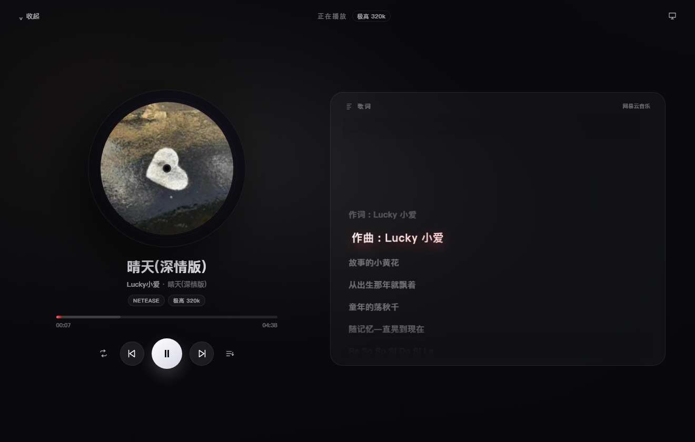

# Aurora Music

一款跨平台桌面音乐播放器：**多音源统一适配 + 搜索下载 + 榜单浏览 + 沉浸式播放与逐行歌词**。
技术栈 Electron + Vue 3 + TypeScript + Vite + Pinia，深色毛玻璃风格，内置离线演示音源，开箱即听。

| 发现页 | 歌词舞台 |
| --- | --- |
|  |  |

| 引擎音源搜索 | 下载管理 |
| --- | --- |
|  |  |

## 功能亮点

- **多音源**：网易云 / QQ 音乐 / 酷我 + musicdl 引擎承载的酷狗、咪咕、千千等 15+ 音源，统一接口，一键切换
- **搜索**：关键词搜索、榜单浏览、跨平台自动换源、引擎音源边解析边出
- **播放**：四种播放模式、队列管理、最近播放、逐行/逐字歌词（网易云 yrc + QQ QRC）、桌面歌词、频谱可视化、五段均衡器
- **下载**：批量入队、并发可配、断点续传、失败自动重试、写入 ID3/MP4 标签与 `.lrc` 歌词
- **本地库**：下载自动入库，支持导入本地目录；收藏与自建歌单，跨音源混放；曲目信息可在应用内编辑（同时写入文件标签与库索引）
- **桌面集成**：系统托盘、全局快捷键（Ctrl+Alt+P/←/→ 与媒体键）、任务栏媒体面板（SMTC，带封面）
- **账号**：扫码或 Cookie 登录 QQ / 网易云，解锁 VIP 曲目与无损音质；只存本机，可随时清除

各音源能力差异见下表（完整设计见 [`docs/ARCHITECTURE.md`](docs/ARCHITECTURE.md)）：

| 音源 | 搜索 | 榜单 | 播放 | 备注 |
| --- | :---: | :---: | :---: | --- |
| 网易云 | ✓ | ✓ | ✓ | 未登录可播非 VIP；无损→320k→128k 回退 |
| QQ 音乐 | ✓ | ✓ | 受限 | Cookie 登录后解锁 VIP 与 QRC 逐字歌词 |
| 酷我 | ✓ | — | ✓ | 免登录 320k，歌词走 LRCLIB 兜底 |
| 酷狗 / 咪咕 / 千千 等（引擎） | ✓ | — | ✓ | 正版曲库，部分有 FLAC |
| 极光精选（内置） | ✓ | ✓ | ✓ | 完全离线，无需账号 |
| 本地音乐 | ✓ | — | ✓ | 下载目录 + 手动导入 |

> 平台接口随时可能变更。单平台故障会被适配层收敛，不影响其它音源与本地播放。

## 快速开始

```bash
npm install
npm run dev           # 开发模式
npm test              # 单元测试
npm run selftest      # 无界面跑通 音源→下载→引擎 全链路
npm run typecheck     # 类型检查
```

## 打包与发版

```bash
npm run dist          # 本地打包（build + electron-builder）
git tag v1.x.x && git push origin v1.x.x   # CI 三平台构建并自动发布 GitHub Release
```

运行时说明：

- 15 个长尾音源（酷狗 / 咪咕 / 千千 / 5sing / B 站 …）由进程内的 TypeScript 引擎承载，
  **安装包不含 Python，也不需要在目标机器上装任何运行时**
- HLS 音源转封装依赖系统中的 `ffmpeg`；缺失时会退回 TS 分片并明确提示

## 平台支持

| 平台 | 状态 |
| --- | :---: |
| Windows 10/11 | 支持（NSIS，主平台） |
| macOS 12+ | 支持（dmg/zip） |
| Linux (X11) | 支持（AppImage/deb） |
| Android / iOS | 不支持（可行性分析见 [`docs/PLATFORM.md`](docs/PLATFORM.md)） |

## 说明

本项目仅用于**学习与技术研究**：只访问各平台公开可访问的端点，不内置任何账号或 Cookie，不托管、不分发任何版权内容。请通过官方渠道获取付费/会员内容，并遵守各平台服务条款。

音源引擎的分页并行、逐首回调与错误码分类借鉴自 `musicdl`（MIT）；实现已全部改为 TypeScript，
运行时不包含 Python，也不再分发上游代码。迁移记录见 [`docs/python-removal.md`](docs/python-removal.md)。
