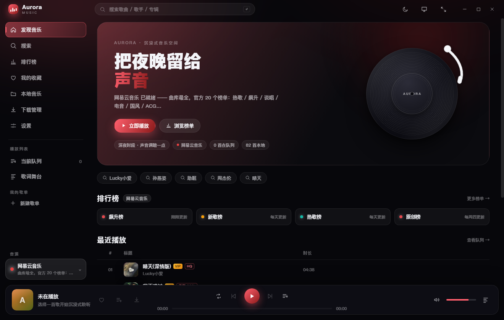
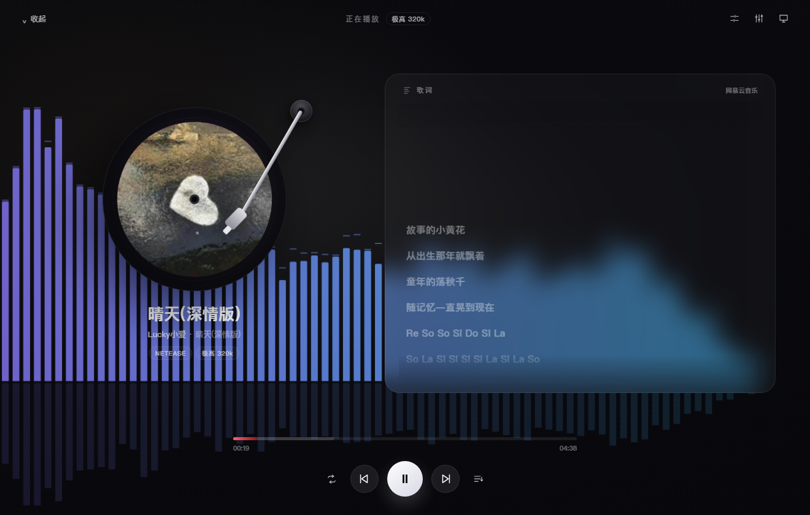
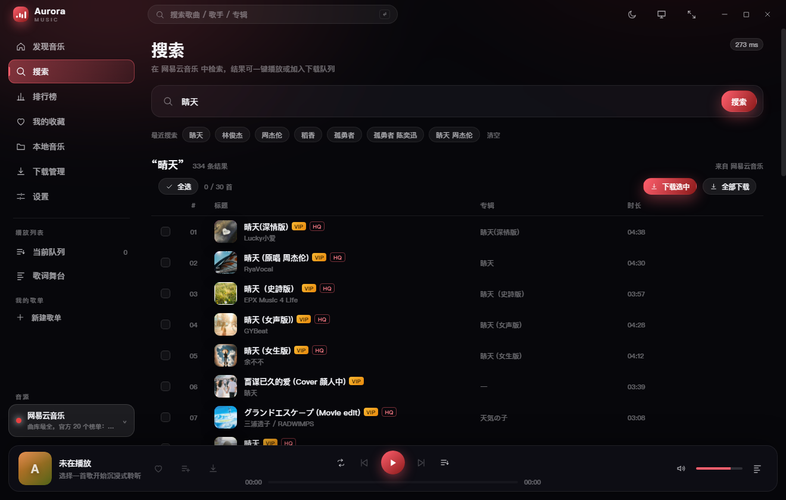
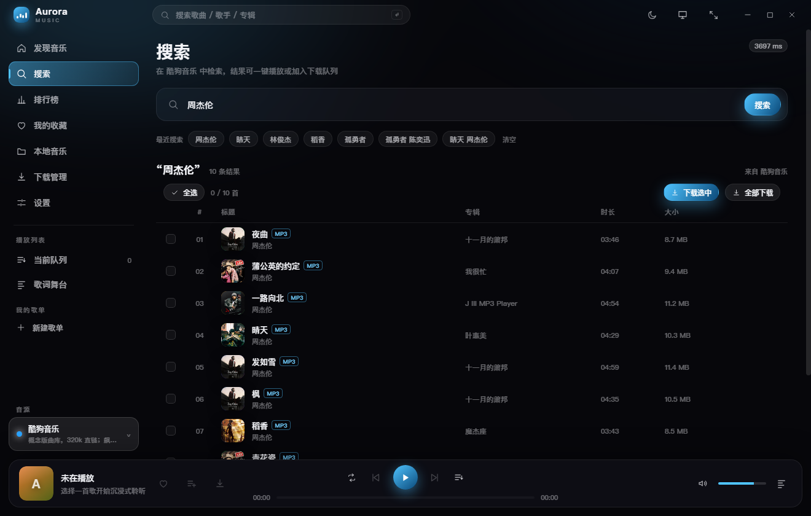
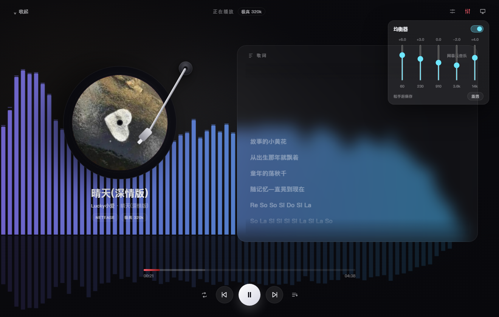
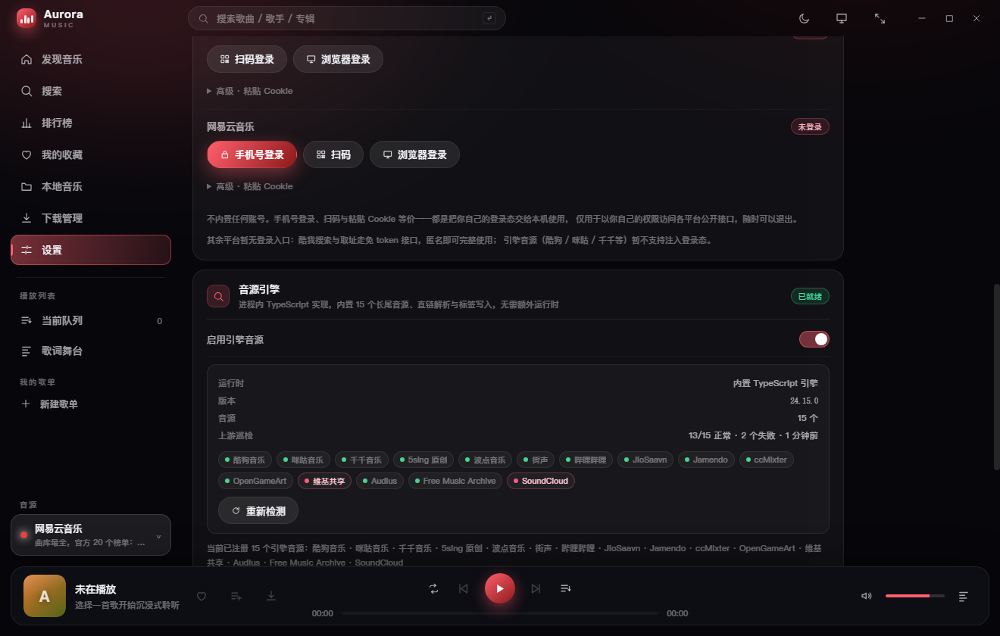
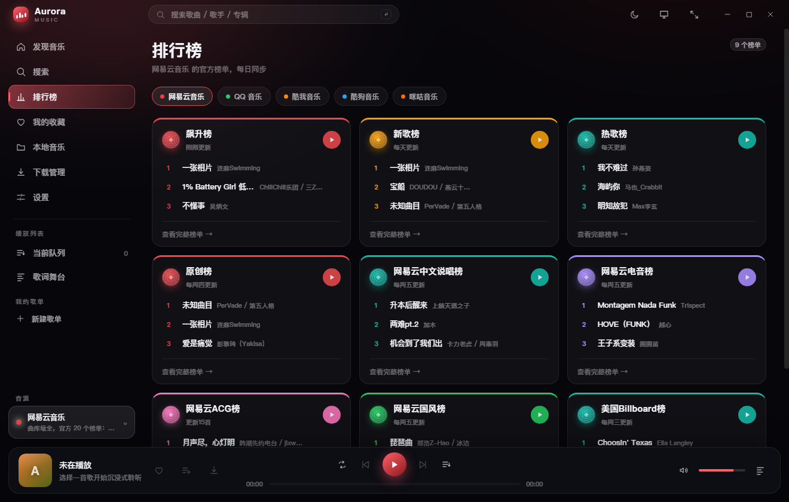
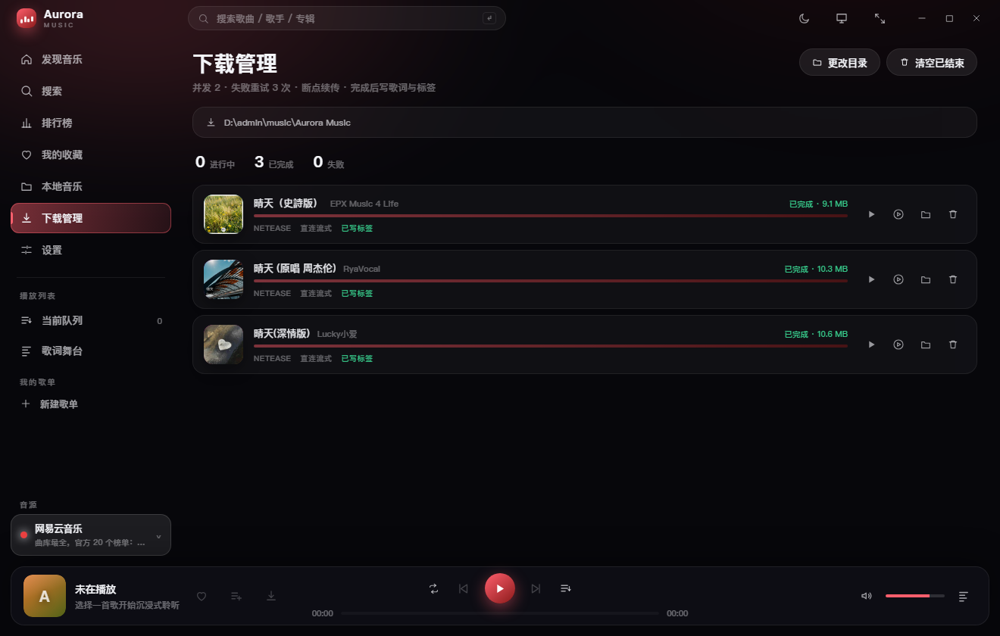
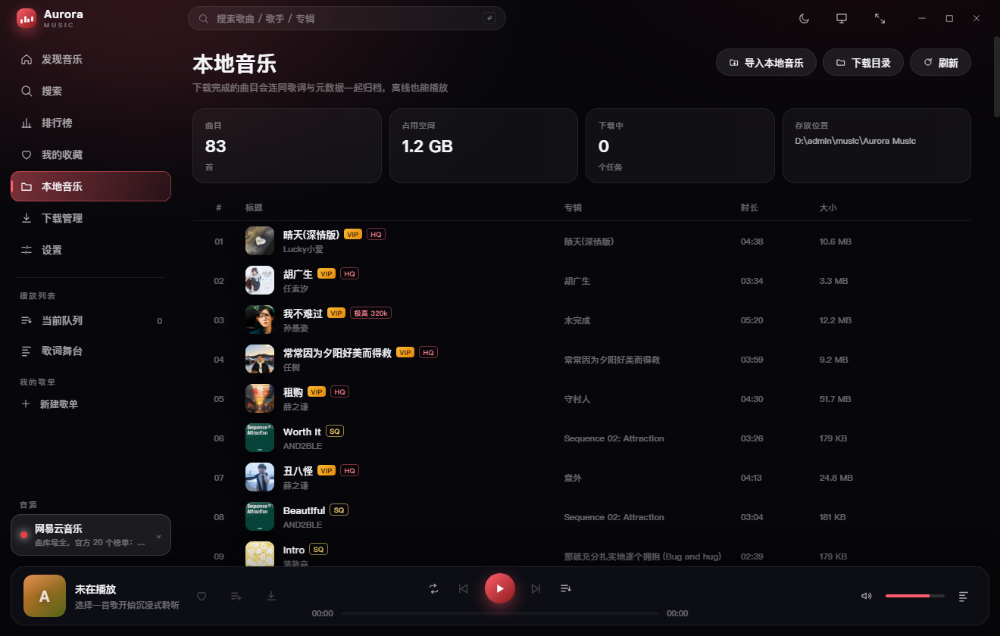

# Aurora Music

一款多音源桌面音乐播放器：**搜索、榜单、下载、本地库、逐字歌词与桌面歌词**，全部在一个窗口里完成。
Electron 40 + Vue 3.5 + TypeScript 5.9 + Vite 6，深色毛玻璃界面；内置离线演示音源，装完不登录也能听。

| 发现 | 正在播放 |
| --- | --- |
|  |  |
| **搜索（网易云）** | **搜索（引擎音源）** |
|  |  |

---

## 功能

| 模块 | 能力 |
| --- | --- |
| **音源** | 20 个音源统一接口：5 个原生适配器 + 15 个进程内引擎音源，侧栏一键切换，无需重启 |
| **搜索** | 关键词搜索、榜单浏览、增量出结果（慢音源解析一首显示一首）、搜索历史 |
| **播放** | 四种播放模式（列表/单曲/随机/顺序）、队列抽屉、最近播放、停滞自愈（同源重取 → 跨源换源） |
| **歌词** | 逐行 LRC / 逐字 YRC（网易云）与 QRC（QQ），桌面歌词窗口（迷你条 / 大字两态、可锁定穿透） |
| **音效** | 五段均衡器（60/230/910/3600/14k，±12 dB）、实时频谱与黑胶动效 |
| **下载** | 批量入队、并发与重试可配、断点续传、`.part` 原子落盘、写 ID3/Vorbis/MP4 标签与 `.lrc` |
| **本地库** | 下载自动入库 + 手动导入目录，收藏与自建歌单跨音源混放，曲目信息可在应用内编辑 |
| **桌面集成** | 系统托盘、全局快捷键（`Ctrl+Alt+P` 播放暂停、`Ctrl+Alt+←/→` 上下一首，macOS 为 `Control+Command`；另支持键盘媒体键）、任务栏媒体面板（SMTC + 封面）、关闭到托盘、自动更新 |
| **账号** | QQ / 网易云扫码或 Cookie 登录，解锁 VIP 与无损；凭据只存本机，可随时清除 |

| 五段均衡器 | 音源引擎与上游巡检 |
| --- | --- |
|  |  |

| 排行榜 | 下载管理 | 本地音乐 |
| --- | --- | --- |
|  |  |  |

## 音源

| 音源 | 搜索 | 榜单 | 播放 | 说明 |
| --- | :---: | :---: | :---: | --- |
| 网易云 | ✓ | ✓ | ✓ | 未登录可播非 VIP；无损 → 320k → 128k 逐级回退 |
| QQ 音乐 | ✓ | ✓ | 受限 | Cookie 登录后解锁 VIP 与 QRC 逐字歌词 |
| 酷我 | ✓ | — | ✓ | 免登录 320k；无封面，歌词走 LRCLIB 兜底 |
| 极光精选（内置） | ✓ | ✓ | ✓ | 完全离线，随包附带三段 wav，用于演示与自检 |
| 本地音乐 | ✓ | — | ✓ | 下载目录 + 手动导入目录 |
| 引擎音源 ×15 | ✓ | — | ✓ | 酷狗 / 咪咕 / 千千 / 5sing 原创 / 波点 / 街声 / 哔哩哔哩 / JioSaavn / Jamendo / ccMixter / OpenGameArt / 维基共享 / Audius / Free Music Archive / SoundCloud |

引擎音源在**搜索阶段就解析真实地址**，所以首条结果 0.7~1.5 s 可见、整批 2~7 s 完成。
设置页的「上游巡检」会在启动 20 s 后给 15 个源各发一次最小搜索，按源标色（绿=正常、黄=能通但搜不到、红=请求失败），结果落盘复用 12 小时。

## 快速开始

需要 Node 20+（开发时使用 22.x）与 npm。

```bash
npm install
npm run dev        # 开发模式（HMR）
npm run build      # 构建主进程 / preload / 渲染层到 out/
npm run typecheck  # vue-tsc + tsc（含 scripts/）
npm test           # 单元测试（Node 原生 test runner）
npm run selftest   # 无界面启动 Electron，跑通「搜索 → 取址 → 下载 → 写标签」全链路
npm run engine:test # 引擎层测试（15 个音源的解析与标签写入）
```

其他脚本：

```bash
npm run dist        # 本地出安装包：typecheck → build → electron-builder
npm run demo:audio  # 重新生成内置演示音频（3 × 1.7 MB wav）
npm run shots       # 重拍文档截图（见 scripts/shots.mjs，需先 npm run build）
```

## 打包与发布

```bash
npm run dist                        # 本机出包（产物在 release/）
git tag v1.3.4 && git push origin v1.3.4   # 打 tag 触发 CI 三平台构建并发布 GitHub Release
```

- CI（`.github/workflows/build.yml`）在 Windows / macOS / Ubuntu 上分别构建，前置四道关口：
  `typecheck → 单元测试 → 引擎测试 → build`。
- 产物命名固定为 `Aurora-Music-<version>-<arch>.<ext>`（**不能含空格**）。
  早期版本用 `${productName}` 拼名字，空格被不同环节规范化成点号/连字符，导致更新器 404。
- 自动更新走 `electron-updater` + `latest.yml`，「下载失败」时会给出可点的手动下载入口。

**安装包约 105 MB 是 Electron 的固定开销**：`electron.exe`（Chromium）205 MB、`locales` 46 MB、
图形后端与 ICU 资源约 70 MB，压缩后约 91 MB；本项目自身的代码压缩后不到 1 MB。
应用运行时不依赖 Python 或任何外部运行时。

## 目录结构

```
src/
  main/                 主进程：所有网络与磁盘操作
    providers/          20 个音源适配器（netease / qq / kuwo / demo / local + 15 个引擎源）
    engine/ts/          进程内音源引擎（签名、分页、HLS、标签写入）
    services/           catalog（搜索/取址/换源）、download、library、playlists、cache、source-health…
    windows.ts          主窗口 / 桌面歌词窗 / 迷你条 / 音量气泡
    protocol.ts         muse:// 媒体协议（封面代理、本地流式读取）
    ipc.ts              81 个 IPC 通道的处理器
  preload/              contextBridge 暴露的 window.api
  shared/               IPC 常量、类型、歌词解析（主进程与渲染层共用）
  renderer/src/
    views/              路由页面 + 两个独立窗口（桌面歌词、音量气泡）
    components/         18 个组件（播放条、歌词、均衡器、队列、歌曲表…）
    stores/             6 个 Pinia store
    core/               audio / wave（Web Audio 图）/ latest（异步门闩）/ plain（IPC 拷贝）
scripts/
  shots.mjs             文档截图流水线
  engine-ts/            引擎构建与测试台
tests/                  单元测试
```

## 数据落在哪

| 内容 | 位置 |
| --- | --- |
| 设置、下载队列、本地库索引、歌单、巡检结果 | `%APPDATA%/aurora-music/`（macOS 为 `~/Library/Application Support/aurora-music`） |
| 下载的音乐与 `.lrc` | 默认 `系统音乐目录/Aurora Music`，可在设置页改 |
| 登录凭据（Cookie） | 同上设置文件，仅本机明文存储，可一键清除 |

## 平台支持

| 平台 | 状态 |
| --- | --- |
| Windows 10/11 | 支持（NSIS 安装包，主目标平台） |
| macOS 12+ | 支持（dmg / zip，保留原生红绿灯与菜单） |
| Linux (X11) | 支持（AppImage / deb） |
| Android / iOS | 不支持（原因与改造路径见 [PLATFORM.md](docs/PLATFORM.md)） |

HLS（m3u8）音源转封装依赖系统的 `ffmpeg`；缺失时会退回 TS 分片并用明确提示告知。

## 已知限制

1. 各平台接口均为非官方公开端点，**随时可能变更**；单源失效会被熔断隔离，不影响其它音源与本地播放。
2. 2026-10-29 的巡检实测中，`wikimedia`（请求失败）与 `soundcloud`（>25 s 超时）不可用，其余 13 个源正常。
   这类结论随时会变，以设置页的实时巡检结果为准。
3. QQ 音乐未登录时绝大多数曲目没有播放权限，实际依赖跨源换源。
4. 引擎音源只返回首屏约 10 条，无分页——分页并行会让耗时翻倍，是有意取舍。
5. 自动更新的完整链路（下载 → 重启安装）需在真机安装版上验证，开发模式无法覆盖。

## 文档

| 文档 | 内容 |
| --- | --- |
| [docs/README.md](docs/README.md) | 文档索引：哪些是现行、哪些是归档 |
| [ARCHITECTURE.md](docs/ARCHITECTURE.md) | 分层、音源接口、缓存与换源调度、下载状态机、Web Audio 图、关键流程 |
| [PLATFORM.md](docs/PLATFORM.md) | 三平台差异与移动端不可行的原因 |
| [mini-player.md](docs/mini-player.md) | 迷你播放窗的三态、悬停面板与尺寸记忆 |
| [desktop-lyric.md](docs/desktop-lyric.md) | 桌面歌词的裸字/悬停两态与绘图取舍 |
| [archive/](docs/archive/README.md) | 历史记录：Python 移除、引擎迁移对拍、Android 方案、2026-10-29 全量审计 |

## 说明

本项目仅用于**学习与技术研究**：只访问各平台公开可访问的端点，不内置任何账号或 Cookie，
不托管、不分发任何版权内容。请通过官方渠道获取付费/会员内容，并遵守各平台服务条款。

音源引擎的分页并行、逐首回调与错误码分类参考了 [`musicdl`](https://github.com/CharlesPikachu/musicdl)（MIT），
实现已全部改写为 TypeScript，运行时不包含 Python，也不再分发上游代码。
