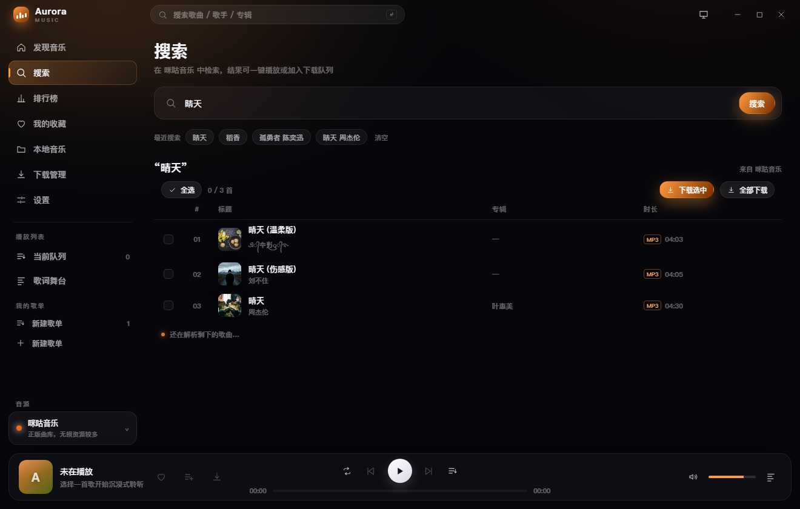
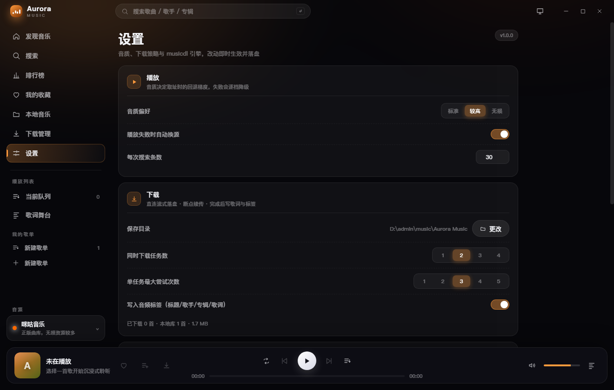
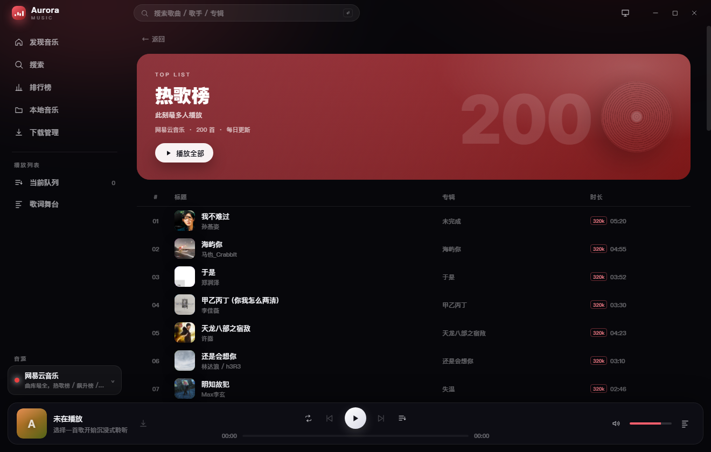
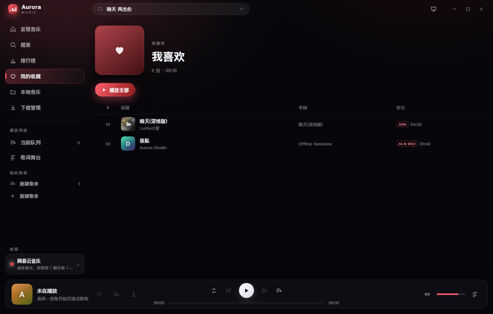
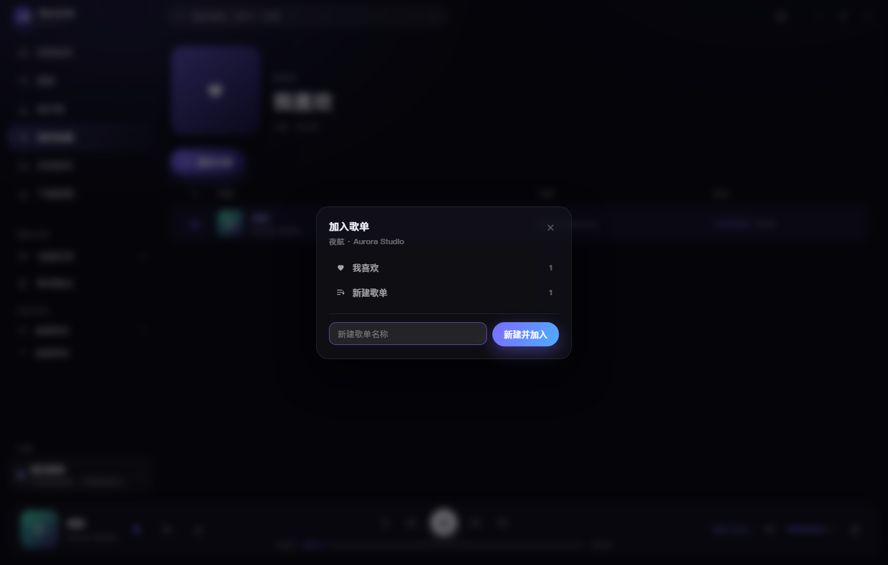
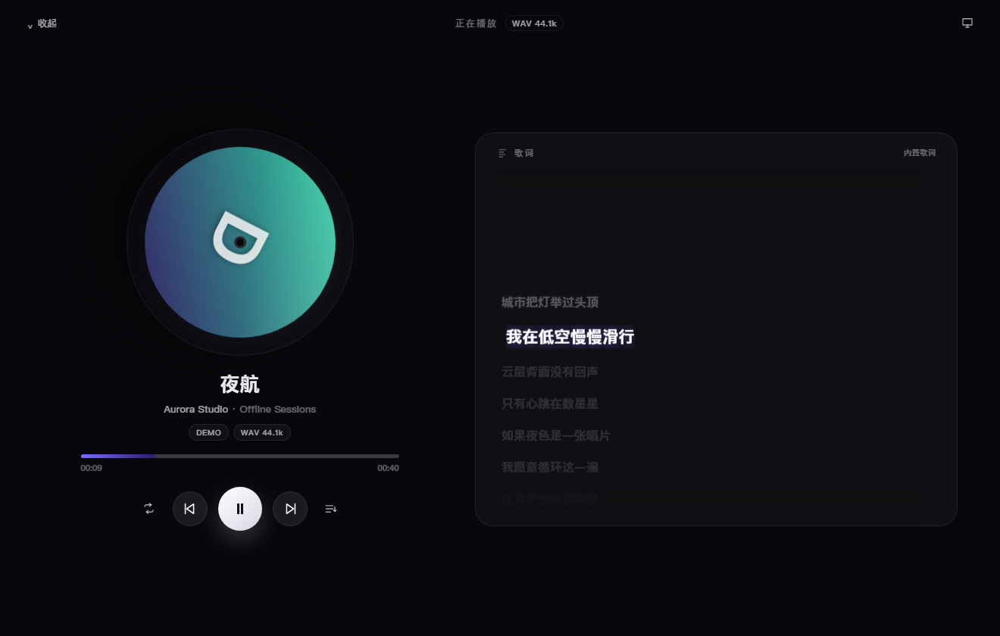
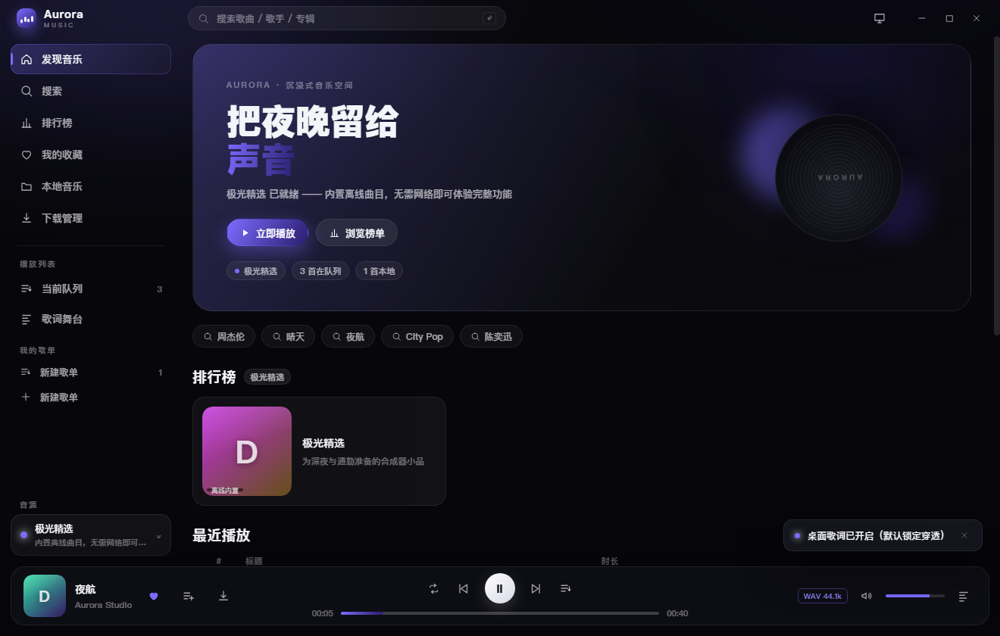
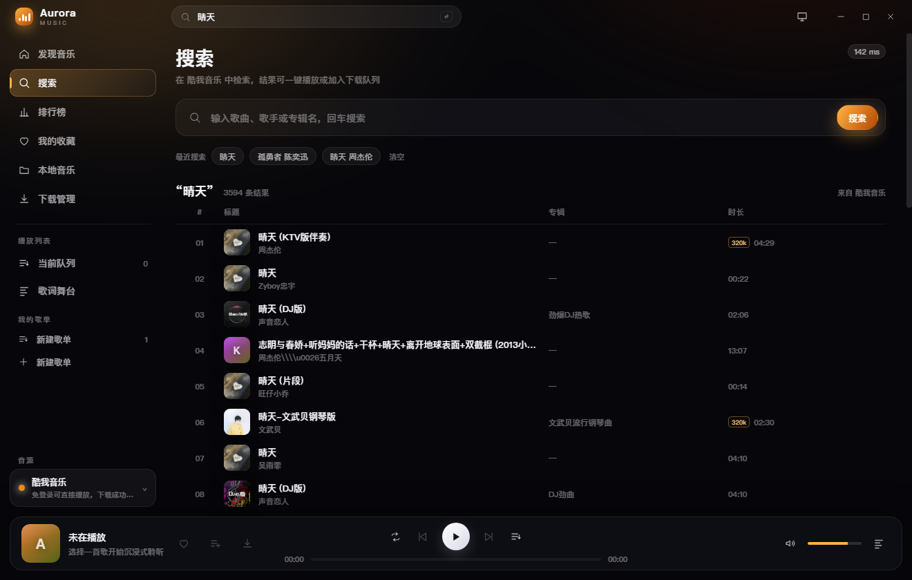

# Aurora Music

一款跨平台桌面音乐播放器：**多音源统一适配 + 搜索下载 + 榜单浏览 + 沉浸式播放与逐行歌词**。
技术栈 Electron + Vue 3 + TypeScript + Vite + Pinia，界面为深色毛玻璃风格，内置离线演示音源，开箱即听。


| 搜索 | 歌词舞台 |
| --- | --- |
|  |  |

| 引擎音源 + 批量下载 | 边搜边出（解析中） |
| --- | --- |
|  |  |

| 设置 | 榜单详情 |
| --- | --- |
|  |  |

| 下载管理 | 本地音乐 |
| --- | --- |
|  |  |

| 我的收藏 | 加入歌单 |
| --- | --- |
|  |  |

| 逐字歌词（karaoke） | 桌面歌词窗口 |
| --- | --- |
|  |  |

| 离线演示曲目 | 封面补全（酷我无封面 → 跨平台取图） |
| --- | --- |
|  |  |

---

## 一、技术选型
| 层次 | 选型 | 理由 |
| --- | --- | --- |
| 桌面容器 | **Electron 40** | 需要 Chromium 的音频/图片能力、透明窗口与置顶（桌面歌词），以及 Node 侧的多线程下载与协议代理 |
| 构建 | **electron-vite 6 + Vite 8** | 主进程 / preload / 渲染进程三端统一构建，主进程热重启、渲染进程 HMR |
| UI | **Vue 3.5 `<script setup>` + TypeScript** | 组合式 API 适合把「播放时钟 / 歌词滚动 / 队列」拆成独立响应式单元 |
| 状态 | **Pinia 3** | 四个 store 分别对应播放、搜索、下载、本地库，边界清晰 |
| 路由 | **Vue Router 4（hash 模式）** | 打包后 `file://` 下无需服务端，`#/desktop-lyric` 还能复用同一份 HTML 承载歌词窗 |
| 样式 | 原生 CSS + CSS 变量 | 毛玻璃、渐变主题、转场都要精细控制，手写比组件库更可控 |
| 网络 | 主进程 `fetch`（undici） | 无 CORS 限制、可自定义 Referer/Cookie、天然支持流式读取（下载进度） |
| 媒体代理 | 自定义协议 `muse://` | `<audio>` 无法设置请求头，而平台 CDN 校验 Referer；同时本地文件需要 Range 才能拖动进度 |
| 持久化 | JSON 原子写入（settings / library / playlists） | 无需额外依赖，文件可读、易恢复 |

> 没有引入 UI 组件库、HTTP 库、ORM 或 electron-store —— 全部能力都在约 9000 行代码（含样式与注释）里，便于二次开发。

---

## 二、分层架构

```
┌──────────────────────────── UI 层（渲染进程） ────────────────────────────┐
│  views/ 发现·搜索·榜单·本地·下载     components/ 播放条·歌词·队列·封面       │
│         ↕ Pinia stores: player / search / download / library / playlists  │
│         ↕ core: AudioEngine(HTMLAudio) · LRC 时钟 · 封面渐变 · 错误归一化   │
└───────────────────────────────┬───────────────────────────────────────────┘
                     window.api（preload contextBridge，类型化 IPC）
┌───────────────────────────────┼───────────────────────────────────────────┐
│ 数据层（主进程 services）      CatalogService  ·  DownloadManager           │
│                                LibraryService · PlaylistService · Settings  │
│                                ↓                                           │
│ 音源层（主进程 providers）     ProviderRegistry                            │
│                                ├─ NeteaseProvider  网易云                  │
│                                ├─ QQProvider       QQ 音乐                 │
│                                ├─ KuwoProvider     酷我                    │
│                                ├─ DemoProvider     内置离线曲目             │
│                                └─ LocalProvider    已下载的本地文件          │
│                                ↓                                           │
│ 传输层                         muse://media 代理（Referer + Range 透传）    │
└───────────────────────────────────────────────────────────────────────────┘
```

**依赖方向严格单向**：UI → IPC → 数据层 → 音源层。UI 不知道任何平台字段，音源层不知道任何 UI 概念。
详细设计见 [`docs/ARCHITECTURE.md`](docs/ARCHITECTURE.md)。

### 目录结构

```
aurora/
├── src/
│   ├── shared/                    # 主进程与渲染进程共享
│   │   ├── types.ts               # Song / Chart / Lyric / DownloadTask / Settings
│   │   ├── ipc.ts                 # IPC 通道常量（唯一事实来源）
│   │   ├── lyric.ts               # LRC 解析、译文合并、二分查找、序列化
│   │   └── api.ts                 # window.api 的类型契约
│   ├── main/
│   │   ├── index.ts               # 生命周期、启动装配、自检/截图模式
│   │   ├── windows.ts             # 主窗口 + 透明置顶歌词窗口
│   │   ├── protocol.ts            # muse:// 媒体代理（Range / Referer）
│   │   ├── ipc.ts                 # 所有 ipcMain.handle
│   │   ├── media.ts               # 媒体 URL 构造函数
│   │   ├── paths.ts               # 引擎 / 脚本 / 资源的路径解析
│   │   ├── engine/
│   │   │   ├── python.ts          # Python 运行时探测、子进程管理、NDJSON 编解码
│   │   │   ├── musicdl.ts         # 引擎的类型化客户端（search/resolve/lyric/tag）
│   │   │   └── types.ts           # 引擎协议类型与错误
│   │   ├── providers/
│   │   │   ├── types.ts           # MusicProvider 接口 + ProviderError
│   │   │   ├── base.ts            # 重试 / 超时 / 表单 / 探测
│   │   │   ├── registry.ts (index)# 注册表 + 换源候选
│   │   │   ├── musicdl.ts         # 引擎承载的音源（酷狗/咪咕/千千/波点/…）
│   │   │   ├── netease.ts qq.ts kuwo.ts
│   │   │   ├── demo.ts local.ts
│   │   ├── services/
│   │   │   ├── catalog.ts         # 搜索/榜单/歌词/播放地址 + 缓存 + 换源
│   │   │   ├── download.ts        # 队列、并发、重试、断点续传、标签、sidecar
│   │   │   ├── library.ts         # 本地曲库索引
│   │   │   ├── playlists.ts       # 收藏与自建歌单
│   │   │   ├── settings.ts        # 设置持久化
│   │   │   └── cache.ts           # TTL + in-flight 合并
│   │   └── selftest.ts            # 无界面链路自检
│   ├── preload/index.ts           # contextBridge 暴露 window.api
│   └── renderer/
│       ├── index.html
│       └── src/
│           ├── App.vue            # 外壳：标题栏/侧栏/路由/播放条/歌词窗推送
│           ├── views/             # Discover / Search / Charts / ChartDetail / Playlist / Library / Downloads / Settings
│           ├── components/        # TitleBar SideBar PlayerBar NowPlaying LyricPane SongTable PlaylistPicker …
│           ├── stores/            # app / player / search / download / library / playlists
│           ├── core/              # audio 引擎、封面渐变、错误归一化、跨进程 plain()
│           └── styles/main.css    # 设计令牌、毛玻璃、动画、路由过渡
├── engine/
│   ├── musicdl/bridge.py          # musicdl 引擎桥（NDJSON over stdio）
│   └── .venv/                     # 引擎专用虚拟环境（npm run setup:engine 创建）
├── tests/core.test.ts             # 纯函数单测（LRC / 命名 / 换源匹配）
├── resources/demo/*.wav           # 内置离线演示音源（脚本生成，无版权）
├── scripts/
│   ├── make_demo_audio.py         # 合成器生成演示曲目
│   ├── setup_engine.py            # 创建引擎虚拟环境并安装依赖
│   └── repair_musicdl.py          # 修复 vendor 源码里的空字节损坏
└── docs/ARCHITECTURE.md
```

---

## 三、快速开始

```bash
npm install
npm run demo:audio     # 生成 3 首内置演示曲目（仅首次需要，仓库已附带）
npm run engine:setup  # 创建 engine/.venv 并安装 musicdl（启用引擎音源，可选）
npm run dev            # 开发模式（HMR）
npm run build          # 构建 out/
npm run typecheck      # vue-tsc 全量类型检查
npm test               # 纯函数单测
npm run selftest       # 无界面跑通 音源→下载→引擎 全链路（真实网络）
npm run preview        # 预览构建产物
```

首次启动默认进入「极光精选」音源，**不需要账号、不需要联网**即可体验播放、歌词同步、下载与本地库。
侧边栏底部可随时切换到网易云 / QQ 音乐 / 酷我，以及由 musicdl 引擎承载的酷狗 / 咪咕 / 千千 / 波点等音源。

> 引擎音源依赖 Python。没装 `engine/.venv` 时应用照常启动，只是这些音源会标为「引擎未就绪」；
> 设置页可以检测引擎状态、看具体报错，也可以用「指定解释器」直接挑一个装好 `musicdl` 的 Python。

---

## 四、功能与边界

| 能力 | 说明 |
| --- | --- |
| 多平台切换 | 统一 `MusicProvider` 接口，运行时切换，新增平台只需实现接口并注册一行 |
| 搜索 | 关键词搜索、分页加载、历史记录、跨平台自动重搜；引擎音源**边解析边出**，解析出一首显示一首 |
| 榜单 | 网易云 4 个榜单、QQ 3 个榜单；不支持榜单的音源会给出切换建议 |
| 播放 | 播放/暂停、上一首/下一首、进度拖拽、音量、四种播放模式、队列增删、系统媒体键 |
| 音波可视化 | 正在播放舞台内嵌 AnalyserNode 真实频谱（muse 代理补 CORS + `crossOrigin`）；三款形态——频谱柱（基线倒影+峰值保持）、声波曲线（双层霓虹辉光）、环形声浪（环绕唱片旋转），形态与配色跟随皮肤切换；analyser 不可用时自动降级为模拟波动 |
| 歌词 | LRC 多时间戳/偏移/译文合并，rAF 驱动逐行高亮滚动，点击歌词跳转 |
| 桌面歌词 | 独立透明置顶窗口；默认**迷你单行条**（播放按钮 + 一行逐字歌词），可切大字三行模式；鼠标穿透锁定，主窗口 250ms 推送 + 子窗口本地插值 |
| 系统托盘 | 关闭窗口最小化到托盘后台播放；托盘菜单显示歌名并提供 播放/暂停、切歌、显示主窗口、退出；左键单击唤起主窗口；关闭按钮是隐藏到托盘还是退出程序，可在设置里选择（托盘不可用或设置关闭时始终为真正退出；Linux 无托盘环境自动回退为原生关闭行为） |
| 全局快捷键 | Ctrl+Alt+P / ← / →（Mac 为 Control+Command）在任意应用中控制播放/暂停与切歌；键位被占用时自动跳过并提示 |
| 下载 | 并发数/重试次数可配置、`.part` 断点续传、实时速度/进度、取消/重试/全部重试、队列落盘重启续跑 |
| 下载引擎 | 默认主进程直连流式落盘；遇到 HLS 或特殊鉴权自动切到 musicdl 引擎下载 |
| 元数据 | 下载完成写入 `.lrc` 与 `.meta.json` sidecar，登记进本地库；可选写入 ID3 / MP4 / Vorbis 标签 |
| 批量下载 | 搜索/榜单列表勾选多首一键入队，带全选与批量工具条 |
| 收藏与歌单 | 红心一键收藏（内置「我喜欢」），自建歌单可新建/重命名/删除，跨音源混放 |
| 逐字歌词 | 网易云 yrc 实时解析为字级时间轴，CSS `calc + clamp` 驱动 clip-path 渐变，零 JS 布局抖动；QQ 音乐登录后走 QRC 逐字歌词（3DES 解密 + 字级时间轴）；桌面歌词窗口独立按 IPC 时间戳插值，60fps 平滑 |
| 账号登录 | 设置里扫码登录（推荐，手机 App 扫一下即用）或粘贴自己的 QQ / 网易云 Cookie（F12 从浏览器复制），即时解锁 QQ 逐字歌词（QRC 解密）、VIP 曲目与网易云无损音质；不内置账号，只存本机，可随时清除 |
| 封面补全 | 酷我/QQ 部分曲目无封面，按歌名到网易云/QQ 跨平台取（去后缀主干匹配，24h 缓存） |
| 换源 | 当前平台无播放权限时，按歌名 + 歌手相似度到其它平台找替代版本；引擎音源带时间预算与次数上限，避免逐个试到超时 |
| 设置页 | 音质偏好、自动换源、搜索条数、下载目录/并发/重试/标签开关、下载引擎、引擎状态检测，改动即时生效并落盘 |
| 失败跳过 | 曲目无法播放时提示并自动跳到下一首（连续 3 次失败后停下，避免连跳） |

### 音源能力矩阵

| 音源 | 搜索 | 榜单 | 播放 | 歌词 | 备注 |
| --- | :---: | :---: | :---: | :---: | --- |
| 网易云 | 支持 | 支持 | 支持 | 支持 | 未登录可播非 VIP 曲目，按 无损→320k→128k 逐档回退 |
| QQ 音乐 | 支持 | 支持 | 受限 | 支持 | 未登录时大量曲目 purl 为空，会自动换源；粘贴 Cookie 后可播 VIP 曲目并解锁 QRC 逐字歌词 |
| 酷我 | 支持 | 暂无 | 支持 | 兜底 | 免登录 320k，歌词走 LRCLIB 兜底 |
| 酷狗（引擎） | 支持 | 暂无 | 支持 | 支持 | 概念版曲库，部分曲目返回 flac |
| 咪咕（引擎） | 支持 | 暂无 | 支持 | 支持 | 正版曲库，无损资源较多 |
| 千千 / 波点 / 5sing / 街声 / B 站（引擎） | 支持 | 暂无 | 支持 | 部分 | 曲库差异大，召回质量随平台波动 |
| Jamendo / ccMixter / Audius 等（引擎） | 支持 | 暂无 | 支持 | 部分 | 海外 CC 授权曲库，国内网络可能需代理 |
| 极光精选（内置） | 支持 | 支持 | 支持 | 支持 | 完全离线 |
| 本地音乐 | 支持 | 暂无 | 支持 | 支持 | 读取下载目录 + 手动导入的本地目录（递归两层）；有 sidecar 用完整元数据，否则从「歌手 - 歌名」文件名解析 |

> 平台接口随时可能变更。适配层已把「取地址失败」「返回 200 却是 HTML」等情况统一收敛为 `ProviderError`，
> 单平台故障不会影响其它音源与本地播放。
>
> 引擎音源（`mdl-*`）的搜索成本显著高于原生音源：musicdl 在搜索阶段就会逐首解析真实播放地址，
> 桥内已按音源标定分页大小以并发化（酷狗约 9s、咪咕约 7s、波点约 10s，10 条/页），
> 并对同一关键词做了 10 分钟缓存与并发去重。
>
> 即便如此也不该让人干等——引擎音源是**边解析边出**的：解析出一首就推一首，
> 首条结果通常 3~4 秒出现，之后每 1~2 秒追加一批，表格实时增长。

---

## 五、新增一个音源

有两条路，按平台复杂度选：

### A. 原生适配器（自己写签名/接口）

```ts
// src/main/providers/example.ts
import { BaseProvider } from './base'
import type { ProviderInfo, SearchPage, StreamInfo } from '@shared/types'

export class ExampleProvider extends BaseProvider {
  readonly info: ProviderInfo = {
    id: 'example',
    name: '示例音乐',
    short: '示例',
    color: '#ff6a00',
    gradient: ['#ff8a3d', '#8a3200'],
    capabilities: { search: true, charts: false, stream: true, lyric: false },
    description: '示例曲库'
  }

  protected baseHeaders() {
    return { 'User-Agent': 'Mozilla/5.0', Referer: 'https://music.example.com/' }
  }

  async search({ keyword, page, limit }): Promise<SearchPage> {
    const data = await this.json<any>(`https://.../search?kw=${encodeURIComponent(keyword)}&p=${page}`)
    return {
      items: data.list.map((item: any) => ({
        id: String(item.id), platform: this.info.id, name: item.name,
        artists: [item.singer], album: item.album, coverUrl: null,
        duration: item.duration * 1000
      })),
      total: data.total, page, hasMore: page * limit < data.total
    }
  }

  async resolveStream(song, quality): Promise<StreamInfo> {
    /* 拿到真实地址后务必 probe 一次，再包成 mediaUrl() 走代理 */
  }
}
```

```ts
// src/main/providers/index.ts
providers.register(new ExampleProvider())
```

### B. 复用 musicdl 引擎（推荐，签名逻辑已被上游维护）

在 `src/main/providers/musicdl.ts` 的 `MUSICDL_SOURCES` 里加一条即可，搜索/取址/歌词全部由引擎完成：

```ts
{ key: 'migu', name: '咪咕音乐', short: '咪咕', color: '#ff6a00', gradient: ['#ff9a3d', '#7a2f00'], description: '正版曲库，无损资源较多' }
```

若该平台在 musicdl 里还没有客户端，则先在 `engine/musicdl/bridge.py` 的 `SOURCES` 登记
`{ "client": "XxxMusicClient", "label": "..." }`，两边各加一行即可。

UI 会自动出现该音源（`provider:list` 读取注册表），榜单页/能力标签按 `capabilities` 自动收敛，无需改任何组件。

### 引擎协议

主进程与 Python 之间是 **NDJSON over stdio**（一行一个 JSON），不用 HTTP、不占端口：

```
→ {"id":1,"cmd":"search","params":{"source":"migu","keyword":"稻香","limit":10}}
← {"id":1,"ok":true,"result":{"items":[...],"total":10,"cost":6734}}
```

支持的 `cmd`：`ping` / `sources` / `search` / `resolve` / `lyric` / `download` / `tag` / `shutdown`。
进程按需懒启动，空闲不占内存；崩溃后下一次调用会自动重启。

---

## 六、桌面歌词

- 两种形态，右下角按钮随时切换，形态记在设置里（`desktopLyricMode`）：
  - **迷你条**（默认）：760×62 单行胶囊，播放/暂停按钮 + 一行逐字歌词，鼠标移上去才露出 上一首 / 下一首 / 大字 / 锁定 / 关闭；
  - **大字模式**：980×200 三行（上一行 / 当前行 / 下一行）+ 译文，可调字号。
- 主窗口每 250ms 推送一次 `{lines, offset, index, time, sentAt}`；子窗口用 `sentAt` 做本地插值，避免网络/定时器抖动造成跳行。
- 迷你条上的播放按钮通过 `lyric-window:command` 发给主进程，再由主进程转发给主窗口执行（播放器实例在主窗口）。
- 窗口尺寸由主进程 `setLyricMode` 统一改（先放开最大尺寸再设新约束，否则旧高度锁会挡住缩放），改完广播形态给子窗口，保证「尺寸」和「布局」不会各说各话。
- 锁定时调用 `setIgnoreMouseEvents(true, { forward: true })`，鼠标完全穿透；解锁后可拖动、缩放、点按钮。
- 再次点击标题栏的「桌面歌词」按钮可关闭窗口，作为锁定后的兜底出口。

---

## 七、开发辅助

```bash
# 纯函数单测（LRC / 命名 / 换源匹配），Node 原生 test runner + type stripping
npm test

# 无界面跑通 音源→下载→引擎 全链路（真实网络）
npm run selftest

# 手动指定引擎运行时（默认自动探测 engine/.venv → 系统 python）
AURORA_PYTHON=/usr/bin/python3 npm run selftest
AURORA_MUSICDL_PATH=/path/to/musicdl npm run selftest

# 截图（用于文档/回归）
AURORA_CAPTURE=docs/shots/x.png ./node_modules/electron/dist/electron.exe out/main/index.js
```

> Windows 下若终端继承了 `ELECTRON_RUN_AS_NODE=1`，请先 `unset ELECTRON_RUN_AS_NODE`（或用 `env -u`），
> 否则 Electron 会以纯 Node 模式启动并报 `protocol is undefined`。

### 打包分发

```bash
npm run dist          # = engine:vendor + build + electron-builder
```

`electron-builder.yml` 的 `extraResources` 带三样东西出去：

| 资源 | 用途 | 来源 |
| --- | --- | --- |
| `resources/demo` | 内置离线演示曲目 | 仓库自带 |
| `resources/engine/musicdl` | 引擎桥脚本 | 仓库自带 |
| `resources/engine/vendor` | musicdl 纯源码（约 1.7MB） | `npm run engine:vendor` 生成 |

**不带 `.venv`**：虚拟环境和平台/解释器版本绑定，不能跨机分发。所以安装版首次使用引擎音源时，
需要目标机器上有 Python 3.10+ 与 `musicdl` 依赖——设置页提供了「指定解释器」按钮，
选一下即可，不用配环境变量。

想让安装包开箱即用，把便携版 Python 运行时放进 `engine/python`（Windows 嵌入式版启用
`import site` 后用 `pip --target` 装依赖；该目录已 gitignore，不进仓库），再解注释
`electron-builder.yml` 里对应的 `extraResources` 条目即可（主进程会自动探测 `resources/python`）。

---

## 八、跨平台支持

| 平台 | 状态 | 说明 |
| --- | :---: | --- |
| Windows 10/11 | 支持 | 主开发平台，NSIS 安装包 |
| macOS 12+ | 支持 | 原生红绿灯 + 应用菜单（Cmd 快捷键），dmg/zip |
| Linux (X11) | 支持 | 自绘标题栏，AppImage/deb |
| Linux (Wayland) | 基本可用 | 桌面歌词的置顶/穿透取决于合成器 |
| Android / iOS | 不支持 | Electron 无移动端运行时，需换技术栈 |

桌面三端的窗口框架、菜单、字体、路径、快捷键已分别适配；推送到 GitHub 后由
`.github/workflows/build.yml` 的三平台矩阵分别产出安装包（mac 的 dmg 必须在 macOS 上打）。

Android 的可行性分析、三条迁移路径（Capacitor / Tauri 2 / 原生重写）与工作量评估见
[`docs/PLATFORM.md`](docs/PLATFORM.md)。

---

## 九、说明

本项目仅用于**学习与技术研究**：只访问各平台公开可访问的网页端点，不内置任何账号、Cookie 或破解逻辑，
不托管、不分发任何版权内容。请通过官方渠道获取付费/会员内容，并遵守各平台服务条款。

`musicdl/` 是上游的 Python 项目（MIT），Aurora 通过 `engine/musicdl/bridge.py` 以子进程方式调用它，
不做任何修改分发；`scripts/repair_musicdl.py` 只用于修复 vendor 目录里被空字节损坏的源码文件。
