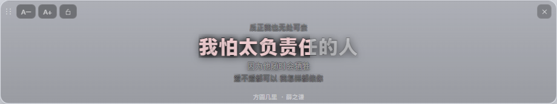
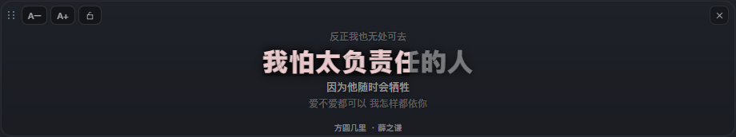
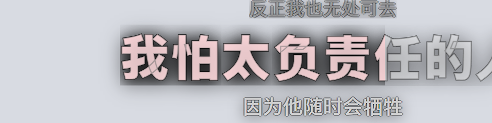

# 桌面歌词：闲置裸字 / 悬停浮出面板

桌面歌词窗口的两种状态，以及为了「没有背景也能读」所做的取舍。

| 状态 | 触发 | 表现 |
|---|---|---|
| **闲置（bare）** | 鼠标不在窗口内 | 全透明：没有面板、边框、投影，也没有工具栏 / 关闭按钮 / 署名。只剩歌词文字 + 描边 |
| **悬停（hover）** | 鼠标进入窗口 | 面板 180ms 淡入（半透明深色 + 1px 边框 + 外投影），同时工具栏、关闭按钮、底部署名淡入 |

过渡只动 `opacity` 与 `box-shadow`，不触发重排；文字本身始终在场，不会跟着面板一起闪。

## 1. 面板为什么画在伪元素上

`background` 是 `linear-gradient`，CSS 无法在两个渐变之间插值，直接过渡 `background` 会硬切。
所以面板画在 `.lyric-window::before`，只过渡 `opacity`：

```css
.lyric-window::before { opacity: 0; transition: opacity .18s ease; z-index: 0 }
.lyric-window:hover::before { opacity: 1 }
```

两个踩过的坑：

- **`z-index: -1` 在透明窗口里完全不可见。** 负层级会被合成器裁掉（实测面板整个消失）。
  改回 `0` 后靠「伪元素是第一个子盒」保证它在文字下面——文字的 `filter` 会生成层叠上下文，
  天然盖在面板之上。
- **投影不能放在伪元素上。** 父级 `overflow: hidden` 会把子盒的投影裁掉，
  所以 `box-shadow` 留在 `.lyric-window` 自身，随 `:hover` 一起过渡。

## 2. 没有面板时怎么保证可读

主歌词是白色渐变字，落在亮壁纸上对比只有约 **1.1:1**（实测面板 `#a1a3a9` / 文字 `#dde2df` 时为 1.92:1）。
裸字状态必须自带轮廓，但**描边只有一种写法能用**：

```css
.line { -webkit-text-stroke: .8px var(--ly-outline); paint-order: stroke fill }
```

不能用 `text-shadow`，也不能用连环 `drop-shadow`：

| 方案 | 结果 |
|---|---|
| `text-shadow` 四向 1px | 这行是 `background-clip: text` 的渐变字，填充色其实是**背景**，而 `text-shadow` 画在背景**之上**——四个偏移副本把整个字形盖成实心黑板，字直接看不见 |
| `drop-shadow()` × 5 | 每次都会把上一轮累积的半透明光晕当作输入再投影，alpha 反复叠加，同样糊成一团黑板 |
| `-webkit-text-stroke` | 只画 1px 边缘，可被逐字的 `.w-base/.w-fill` 继承，字心仍是渐变 |

小字（上一行 / 下一行 / 署名）是实色字，`text-shadow` 反而合适，用 `--ly-outline-soft` 做 0.8px 四向细描边。

配套的对比度微调（都只在深色调色板，歌词窗口恒定深色）：

| 变量 | 原值 | 现值 | 原因 |
|---|---|---|---|
| `--ly-wbase`（未唱部分） | 0.28 | 0.42 | 没有面板时 28% 白几乎归零，看不出唱到哪 |
| `--ly-fg-3`（署名 / 上下行） | 0.32 | 0.45 | 同上 |

## 3. 拖动与缩放：窗口为什么不可 `resizable`

早先窗口是 `resizable: true`，靠 `-webkit-app-region: drag` 拖动。两个问题叠加起来会出事：

1. 透明无边框窗上 `app-region: drag` 在 Windows **整块失效**（拖拽区判不中），所以拖动早就改成了
   渲染层上报 `screenX/Y` 位移、主进程 `setBounds` 移动；
2. 可缩放的无边框窗，Windows 会在四周留一圈**约 8px 的隐形缩放边框**。按在那圈上时事件直接进系统，
   DOM 收不到 `mousedown`，光标变成「圆圈带斜杠」，系统把这当成边缘拉伸——**按住不动窗口就一路变大**。

这不是确定性的代码路径，取决于按下点是否落在隐形边框内，所以「这台机器复现、那台不复现」。
修法是釜底抽薪：

- 创建时 `resizable: false` + `maximizable/minimizable: false`，隐形边框彻底消失；
- 拖动全程 `setBounds`，把尺寸钉回按下瞬间的值；拖动期间监听 `resize`，被任何来源改动都立刻掰回
  （60 秒看门狗 + 失焦兜底，防止 `mouseup` 丢在窗口外后尺寸锁一直生效）；
- 尺寸改由右下角**显式把手**控制：悬停浮现两道斜线，`pointer-events` 平时为 `none` 不抢点击；
  按下记窗口矩形，移动按光标位移算新宽高，按形态最小尺寸（full 480×118，mini 高度锁死）与屏幕工作区夹取；
- 拉伸与移动互斥，两种手势期间都不切鼠标穿透——否则 `mousemove/mouseup` 会被掐断，手势卡在半路。

锁定（穿透）状态下没有手势，不能拉伸；尺寸与位置都不跨重启记忆，每次回到默认值。

## 4. 已知边界

- **闲置时窗口仍然拦截点击**（未锁定时）。透明区域会挡住桌面，这是「无边框、可拖动」的代价；
  要完全不挡桌面，用工具栏的锁定按钮（穿透），鼠标移上去会临时恢复交互。
- **歌词窗口不跟随主题**：始终使用深色调色板，`html[data-theme='light']` 那套 `--ly-*` 目前不会生效。
- 面板淡入不改变窗口尺寸，所以窗口四周没有额外留白，投影只在窗口内可见。

## 5. 截图

| 闲置（亮壁纸） | 悬停（亮壁纸） |
|---|---|
|  |  |

| 闲置（暗壁纸） | 悬停（暗壁纸） |
|---|---|
|  |  |

3 倍放大：描边只占 0.8px，字心仍然是渐变——


