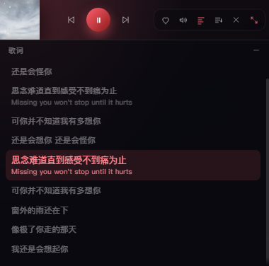
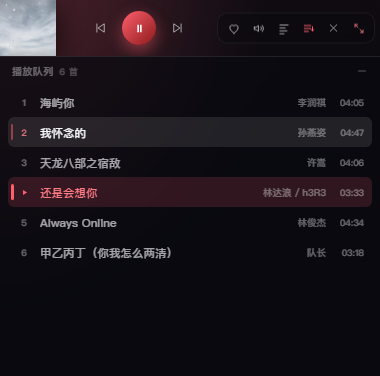
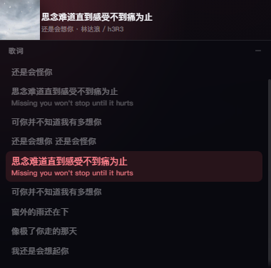

# 迷你播放窗口：状态、交互与布局

迷你窗口是主窗口收缩后的形态（`settings.miniMode = true`），尺寸 **380 × 56**（展开后 380 × 376）。
实现分两处：

| 位置 | 职责 |
|---|---|
| `src/main/windows.ts` | 窗口形态切换、高度生长方向、位置记忆 |
| `src/renderer/src/components/MiniPlayer.vue` | 悬停状态、歌词/队列面板、全部交互 |

---

## 1. 三个状态

| 状态 | 触发条件 | 迷你条内容 | 下方面板 |
|---|---|---|---|
| **闲置（idle）** | 鼠标不在窗口内，且面板未展开 | 封面 + 当前歌词（无歌词时显示歌名）+ 歌名·歌手 | 无 |
| **悬停（hover）** | 鼠标进入窗口 | 封面 + 上一首 / 播放暂停 / 下一首 + 动作组（收藏、音量、歌词、队列、关闭、展开） | 保持当前状态 |
| **面板展开（panel）** | 点击「歌词」或「队列」按钮 | 同悬停态（鼠标移出后退回 idle 样式） | 歌词列表 / 播放队列，高 320 |

**悬停与展开是两个独立维度**：展开后把鼠标移出窗口，动作组会隐藏、只留歌词与封面，
但下方面板保留——面板本身就是歌词内容，不应跟着鼠标消失。

## 2. 悬停：触发条件与时机

| 事件 | 时机 | 原因 |
|---|---|---|
| `mouseenter` | **立即**进入 hover | 进入就该给反馈，加延迟会显得迟钝 |
| `mouseleave` | **延迟 260ms** 退出 hover | 鼠标贴边移动会反复触发 enter/leave；260ms 内移回则取消定时器，不会出现闪烁的中间态 |
| 拖拽窗口 | 不改变 hover | 拖拽区在窗口内，`mouseleave` 不会触发 |

> 悬停只改变「显示什么」，不改变窗口尺寸。

## 3. 过渡效果

| 元素 | 属性 | 时长 / 曲线 |
|---|---|---|
| 歌词（idle） | `opacity 1→0`、`translateY(0→-3px)` | 160ms `--ease` |
| 播放控制组 | `opacity 0→1`、`translateY(3px→0)` | 180ms `--ease` |
| 动作组 | `opacity 0→1`、`translateX(4px→0)` | 180ms `--ease` |
| 面板内容 | `opacity 0→1`、`translateY(-6px→0)` | 200ms `--ease` |

窗口高度变化本身没有动画（Electron 不支持尺寸补间），用面板内容的淡入掩盖高度跳变。

## 4. 歌词展开：布局与显示行为

**布局**

```
┌────────────────────────────────────────────┐
│ 封面 56×56 │ 歌词行 / 歌名·歌手 │ 动作组    │  56px（迷你条，始终存在）
├────────────────────────────────────────────┤
│ 歌词                      8 行        ⌄    │  28px（面板标题 + 收起）
│ 还是会怪你                                  │
│ 思念难道直到感受不到痛为止                   │  ← 当前行：accent 色、12.5px、加粗、底色
│ Missing you won't stop until it hurts       │  ← 译文：10px，同行显示
│ …                                           │  292px（可滚动）
└────────────────────────────────────────────┘
```

- 面板总高 **320px**，窗口从 56 → **376**。
- 列表行高自适应（约 30–34px），超出滚动；顶部/底部各有 10–12px 渐隐遮罩，避免硬切。
- 当前行：`accent` 色文字 + 12% accent 底色 + 字号放大到 12.5px；其余行 `--text-3`。
- 滚动条宽 4px，半透明。

**显示行为**

| 行为 | 规则 |
|---|---|
| 自动跟随 | `activeLyricIndex` 变化时，把当前行滚到面板垂直居中（smooth） |
| 手动浏览 | 在面板内滚动或按下指针后，**暂停自动跟随 4.5s**，避免刚翻下去就被拉回 |
| 点击某行 | `seekTo(line.time - lyric.offset)`，立即跳转到该行 |
| 无歌词 | 显示「暂无歌词」，不再显示空行 |
| 收起 | 点标题栏右侧「—」、再点一次「歌词」按钮、按 `Esc` |

## 5. 队列面板

与歌词共用同一块面板，点「队列」按钮切换：

- 每行：序号 / 歌名 / 歌手 / 时长；当前项显示播放三角 + accent 色 + 16% accent 底色 + 3px 左侧竖条。
- **悬停反馈**：鼠标移入的行背景提亮到 `color-mix(--text 10%)`，左侧出现 2px accent 竖条（50% 不透明），
  序号变为 accent 色。只靠背景提亮在深色底上不够明显，竖条用来明确「指向哪一行」。
- 点击非当前项 → `playAt(index)`；点击当前项 → 播放/暂停。
- 展开时自动把当前项滚到可视区中间。

## 6. 音量气泡（点击音量图标）

迷你条只有 56 高，且**主窗口不透明**——浮层画在窗口内会露出深色底，无法像参考图那样"浮在条外面"。
因此音量用**独立透明窗口**承载（236 × 56 = 8 + 40 卡片 + 8 三角），布局对齐参考图：

```
        ┌──────────────────────────────┐
        │  ●━━━━━━━━━━━━━━━━━━━━━━━━━━  │  深色气泡，横向滑块
        └──────────────▼───────────────┘  三角尖端对准音量按钮中心
┌────────────────────────────────────────┐
│ 封面 │ 歌词 │ ♥ 🔊 ☰ ✕ ⤢               │  56px 迷你条
└────────────────────────────────────────┘
```

- **位置**：气泡在迷你条上方，间隙 2px；**右边缘比迷你条右边缘内缩 9px**，
  这样三角尖端（距气泡右边缘 112px）正好落在音量按钮中心（距条右边缘 121px），实测偏差 0.5px。
- **翻转**：上方放不下时翻到迷你条下方，三角一并旋转 180° 朝上（`placement: 'below'`），
  否则箭头会指向远离迷你条的一侧。
- **越界保护**：x/y 都夹进当前显示器工作区，贴边放置也不会跑到屏幕外。
- **滑块**：横向，点击轨道任意位置直接跳转，按住可拖动；accent 渐变填充 + 白色 thumb；
  滚轮可 ±5% 微调。
- **双向同步**：拖动滑块 → `miniVolumeSet` → 主窗口 `player.setVolume()`；
  主窗口用滚轮/快捷键改音量 → `miniVolumePush` 推回气泡，滑块不会停在旧位置。
- **关闭**：再点音量图标、点气泡外部（失焦）、按 `Esc`；切回完整窗口时自动收起。
- **跟随**：迷你条移动/缩放时气泡实时重定位，不会留在原地。
- **配色与迷你条统一**：同一套变量——`--bg/--bg-soft` 渐变 + 左上角 `--accent` 光晕；
  边框是 `accent` 与 `--border-strong` 的混合；滑块用 `--accent → --accent-2` 渐变；
  三角用 `var(--bg)`（在下方时用 `var(--bg-soft)`）与卡片衔接。深浅主题都跟随（`data-theme`）。
- 独立窗口**拿不到主窗口运行时设置的 `--accent`**，所以打开气泡时由主窗口把
  `accent / accent2 / theme` 一起传过去；切换音源或主题时通过 `miniVolumePush` 实时刷新。

### 6.1 两个曾经踩过的坑

**位置落在屏幕角落**：`positionVolumePopup()` 原本要求窗口"已可见"才定位，而调用点在
`show()` 之前，于是每次都直接 return，气泡停在系统给的默认位置——离迷你条很远，
用户自然不会去拖它，表现就是「音量控制没用」。现在定位加了 `force` 参数，
在 `show()` 前先算好位置，`show()` 后再补一次（Windows 会按 DPI 纠正尺寸）。
**滑块能动但声音不变**：`AudioEngine.setVolume` 只改 `el.volume` 而不打断正在跑的
`fadeTo`（播放开始后 420ms 的淡入），淡入每 16ms 用插值覆盖一次，用户刚拖到的值会在几帧内被拉回。
现在 `setVolume` 先 `stopFade()` 再赋值。

> 实现位置：窗口与定位在 `main/windows.ts` 的 `toggleVolumePopup` / `positionVolumePopup`；
> 界面在 `renderer/src/views/VolumePopup.vue`（独立路由 `#/volume-popup`，不挂 Pinia/router）。

## 7. 窗口尺寸与生长方向（主进程）

`setMiniExpanded(expanded)` 只改高度、不改宽度：

1. **优先向下生长**：保持顶边 `y` 不变，高度 376。
2. **方向可指定**：歌词/队列向下 320px；空间不足时自动翻到另一侧。
3. **收起/切换**：以「收起态迷你条的顶边」为锚点，切换到另一个面板时迷你条不会跳动。

顺序敏感：先把 `setMaximumSize(0, 0)` 放开，再设新的上下限，最后 `setBounds`；
否则上一次的最大高度会把新高度钳掉。

面板展开状态**不持久化**：关闭窗口时只记收起后的 380×56，
下次启动或重新进入迷你态都从收起态开始。

## 8. 其他交互

| 操作 | 结果 |
|---|---|
| 滚轮（迷你条上） | 音量 ±5%，副行临时显示「音量 65%」1.2s |
| 点击音量图标 | 弹出独立音量气泡（详见第 6 节） |
| 双击空白处 | 展开完整窗口 |
| 点「✕」 | `winClose()`，按 `closeToTray` 设置隐藏到托盘或退出 |
| 点「⤢」 | `miniMode = false`，恢复完整窗口 |
| `Esc` | 收起面板（不影响播放） |
| 空格 / 方向键 | 沿用全局快捷键（播放暂停、快进快退、音量） |

## 9. 已知边界

- 面板展开时拖动迷你条，窗口位置改变后 `miniGrewUp` 的锚点可能不再准确；
  收起时会按当前窗口底边还原，极端情况下会有一次位置跳动。
- 迷你窗口固定 380 宽，不支持用户拉伸；宽度是按「三键控制 + 六个动作图标」的
  最窄可点尺寸定的，再窄就会挤掉点击热区。
- 歌词面板的高度是常量（320）。歌词只有两三行时下方会留白，属预期。

---

## 10. 界面参考

| 闲置（只留歌词） | 悬停（操作可见） |
|---|---|
|  |  |

| 歌词展开 | 队列展开（第 2 行为悬停态） |
|---|---|
|  |  |

| 音量气泡（深色） | 音量气泡（浅色） |
|---|---|
|  |  |

| 上方放不下时翻到下方（三角朝上） |
|---|
|  |

| 展开后移出窗口（操作隐藏、面板保留） |
|---|
|  |
